# GEO7531 — Créer, restaurer et sauvegarder une base PostgreSQL / PostGIS avec pgAdmin 4

> ## 📚 Tutoriels du cours
>
> | Tutoriel | Contenu |
> |---|---|
> | **Créer, restaurer et sauvegarder une base** (cette page) | pgAdmin : création, PostGIS, *Restore*, *Backup* |
> | [**Importer des données dans PostGIS**](importation-postgis/README.md) | psql, `\copy`, shp2pgsql, ogr2ogr, raster2pgsql, NDVI, LiDAR, EXPLAIN ANALYZE |
> | [**Installer les extensions de géomatique**](extensions-postgis/README.md) | PostGIS, raster, topologie, SFCGAL, pgRouting, ogr_fdw, H3, pointcloud, recherche de noms, MobilityDB |

Ce guide présente, dans l'ordre, les quatre opérations à maîtriser pour le cours :

1. **Créer** une nouvelle base de données
2. **Ajouter l'extension PostGIS** à cette base
3. **Restaurer** des données à partir d'un fichier de sauvegarde (`.backup`)
4. **Sauvegarder** votre base pour la conserver ou la remettre

L'exemple utilise la base `GEO7531` et le jeu de données NYC (`nyc_data.backup`) fourni pour les exercices.

---

## Table des matières

- [Avant de commencer](#avant-de-commencer)
- [Étape 1 — Créer la base de données](#étape-1--créer-la-base-de-données)
- [Étape 2 — Ajouter l'extension PostGIS](#étape-2--ajouter-lextension-postgis)
- [Étape 3 — Restaurer les données](#étape-3--restaurer-les-données-restore)
- [Étape 4 — Sauvegarder la base](#étape-4--sauvegarder-la-base-backup)
- [Alternative en ligne de commande](#alternative-en-ligne-de-commande)
- [Problèmes fréquents](#problèmes-fréquents)

---

## Avant de commencer

- PostgreSQL 16 et pgAdmin 4 sont installés, et vous êtes connecté au serveur **PostgreSQL 16** dans pgAdmin.
- Vous avez téléchargé le fichier de données du cours, par exemple `nyc_data.backup`.
- Évitez les accents et les espaces dans les chemins de fichiers : c'est une source d'erreurs fréquente.

---

## Étape 1 — Créer la base de données

1. Dans l'**Object Explorer** à gauche, dépliez **Servers → PostgreSQL 16**.
2. Faites un **clic droit sur `Databases`**, puis **Create → Database...**
3. Onglet **General** :
   - **Database** : `GEO7531`
   - **Owner** : laissez `postgres`
4. Cliquez sur **Save**.

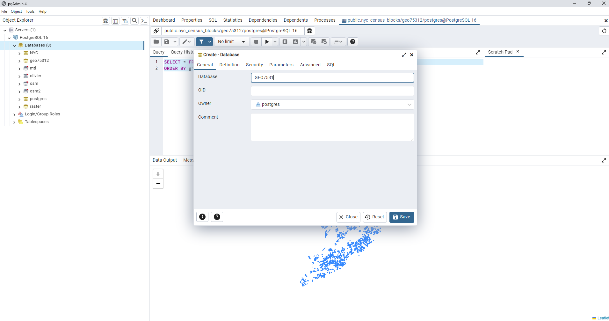

La base `GEO7531` apparaît dans la liste des bases de données.

---

## Étape 2 — Ajouter l'extension PostGIS

Les données du cours contiennent des géométries. **PostGIS doit être activé avant la restauration**, sinon vous obtiendrez l'erreur `type "geometry" does not exist`.

1. Dépliez la base **GEO7531**.
2. Faites un **clic droit sur `Extensions`**, puis **Create → Extension...**
3. Dans le champ **Name**, tapez `postgis`, puis **cliquez sur `postgis` dans la liste** qui s'affiche.
   Le message « 'Name' cannot be empty » disparaît dès que l'extension est sélectionnée dans la liste.
4. Cliquez sur **Save**.

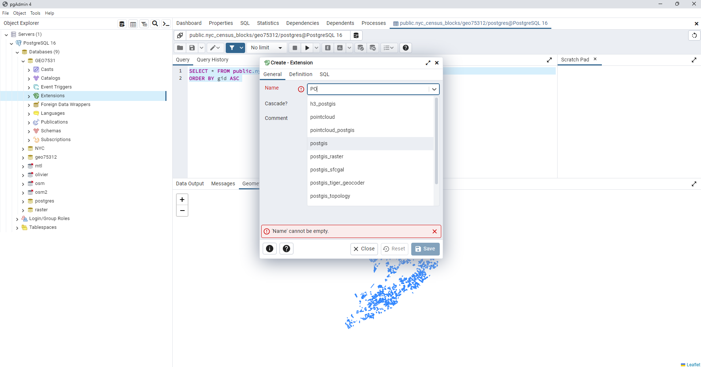

Dépliez **Extensions** : vous devez voir `plpgsql` et `postgis`.

> 💡 Vous pouvez aussi ouvrir le **Query Tool** sur la base (clic droit → *Query Tool*) et exécuter :
> ```sql
> CREATE EXTENSION IF NOT EXISTS postgis;
> ```

---

## Étape 3 — Restaurer les données (*Restore*)

### 3.1 — Ouvrir la fenêtre de restauration

Faites un **clic droit sur la base `GEO7531`**, puis **Restore...**

Le message « Please provide a filename » est normal : aucun fichier n'est encore choisi.

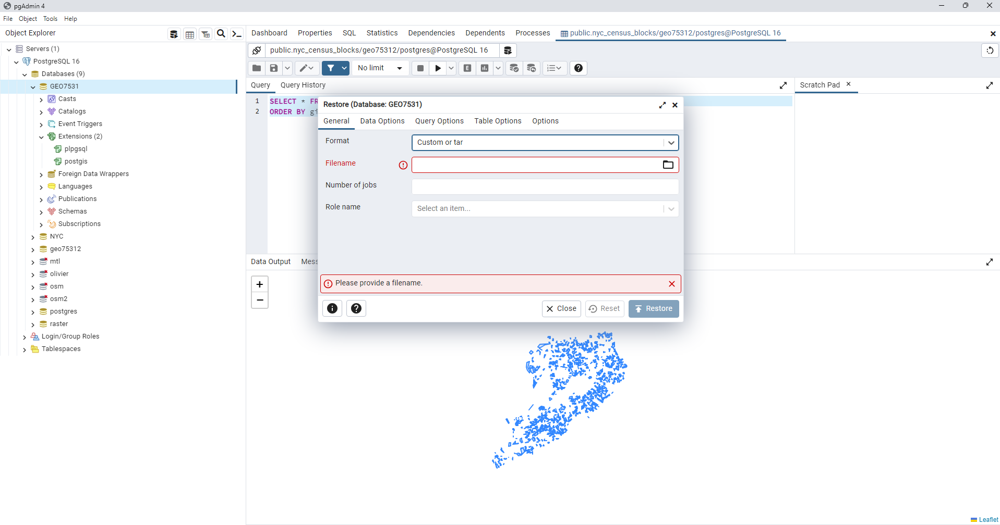

### 3.2 — Onglet *General*

1. **Format** : `Custom or tar`
2. **Filename** : cliquez sur l'icône de dossier 📁 et sélectionnez votre fichier `.backup`.
   Si le fichier n'apparaît pas, changez le filtre en bas de la fenêtre pour **All files**.
3. **Role name** : laissez vide.

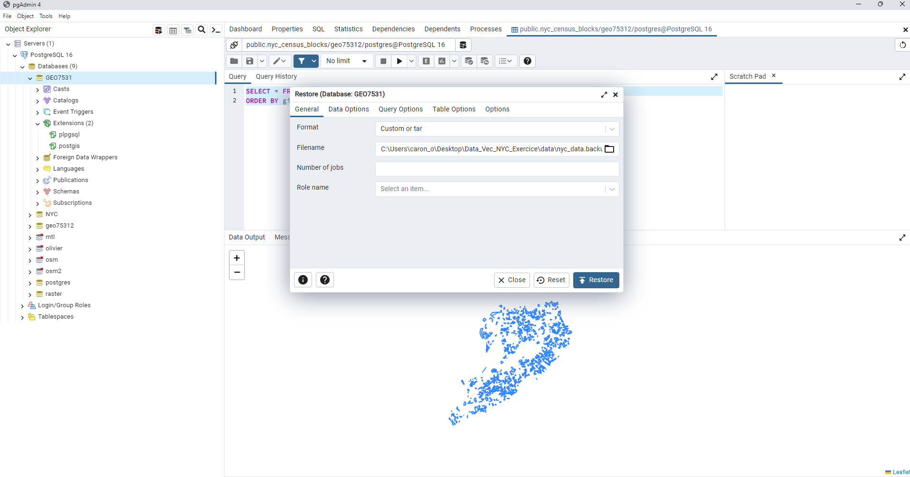

### 3.3 — Onglet *Query Options*

Activez **Single transaction**. Si une erreur survient, rien n'est importé : vous évitez ainsi une base à moitié restaurée.

Laissez **Clean before restore** désactivé, puisque la base est vide.

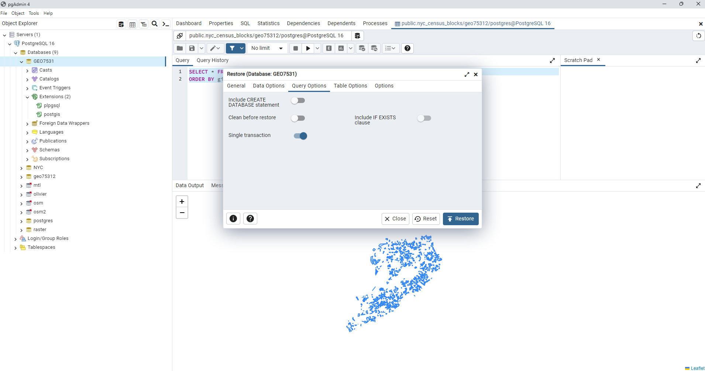

Cliquez sur **Restore**.

### 3.4 — Vérifier la restauration

Attendez la notification **Process completed** en bas à droite. En cas de problème, cliquez sur **View Processes** pour lire le message d'erreur.

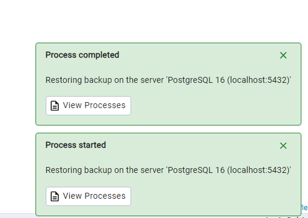

Faites un clic droit sur la base → **Refresh**, puis dépliez **Schemas → public → Tables**. Vous devez voir les tables du jeu de données :

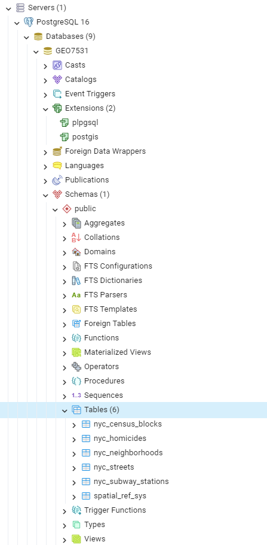

Vous pouvez aussi vérifier avec le **Query Tool** :

```sql
-- Liste des couches géométriques
SELECT f_table_name, f_geometry_column, type, srid
FROM geometry_columns;

-- Nombre de lignes dans une table
SELECT COUNT(*) FROM nyc_census_blocks;
```

---

## Étape 4 — Sauvegarder la base (*Backup*)

À faire après avoir travaillé dans la base : pour la remettre avec un TP, la transférer sur un autre ordinateur ou vous protéger d'une erreur.

### 4.1 — Ouvrir la fenêtre de sauvegarde

Faites un **clic droit sur la base `GEO7531`**, puis **Backup...**

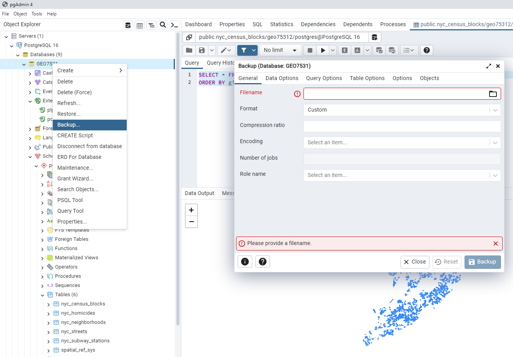

### 4.2 — Onglet *General*

1. **Filename** : cliquez sur l'icône de dossier 📁, choisissez un dossier et donnez un nom au fichier.
2. **Format** : `Custom`
3. **Encoding** : `UTF8`, important pour les accents.
4. **Role name** : laissez vide.

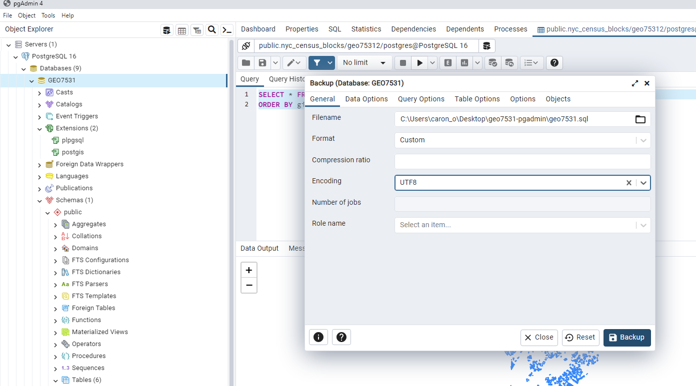

> ⚠️ **Extension du fichier :** avec le format **Custom**, nommez votre fichier avec l'extension **`.backup`**, par exemple `geo7531.backup`.
> Le fichier produit n'est **pas** un script SQL, même si vous le nommez `.sql`. Il ne s'ouvre donc pas dans un éditeur de texte ni dans le Query Tool, et doit être restauré avec **Restore...** (étape 3).

### 4.3 — Onglet *Data Options*

Laissez les valeurs par défaut pour une copie complète (structure et données) :

- **Sections** : *Pre-data*, *Data* et *Post-data* activés
- **Only data** et **Only schemas** désactivés

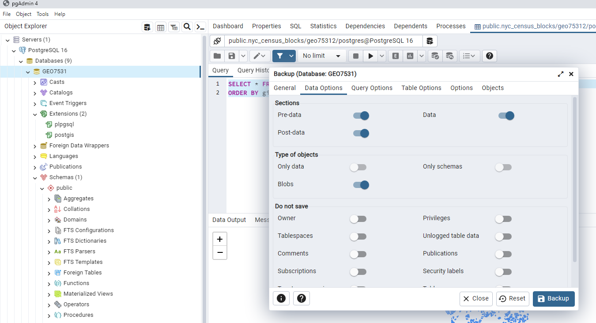

Cliquez sur **Backup**.

### 4.4 — Vérifier la sauvegarde

Attendez la notification **Process completed**.

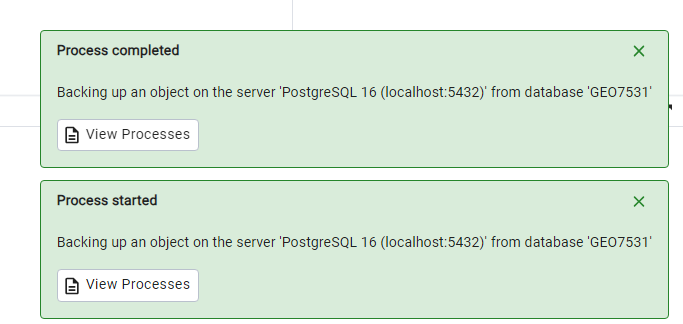

Vérifiez ensuite dans l'Explorateur Windows que le fichier existe et qu'il n'est pas vide (0 Ko).

---

## Alternative en ligne de commande

Les mêmes opérations sont possibles avec les scripts du dossier [`scripts/`](scripts/) :

| Script | Système | Rôle |
|---|---|---|
| [`restauration.bat`](scripts/restauration.bat) | Windows | Crée la base, active PostGIS et restaure le fichier (étapes 1 à 3) |
| [`sauvegarde.bat`](scripts/sauvegarde.bat) | Windows | Sauvegarde une base dans un fichier `.backup` horodaté (étape 4) |
| [`restauration.sh`](scripts/restauration.sh) | macOS / Linux | Équivalent de `restauration.bat` |
| [`sauvegarde.sh`](scripts/sauvegarde.sh) | macOS / Linux | Équivalent de `sauvegarde.bat` |

Sous Windows, vérifiez d'abord la ligne `PG_BIN` au début des fichiers `.bat` : elle doit pointer vers le dossier `bin` de votre PostgreSQL, par exemple `C:\Program Files\PostgreSQL\16\bin`.

Commandes équivalentes :

```bash
createdb -U postgres GEO7531
psql -U postgres -d GEO7531 -c "CREATE EXTENSION IF NOT EXISTS postgis;"
pg_restore -U postgres -d GEO7531 --no-owner --single-transaction nyc_data.backup
pg_dump -U postgres -F c -E UTF8 -f geo7531.backup GEO7531
```

---

## Problèmes fréquents

| Message ou symptôme | Cause probable | Solution |
|---|---|---|
| `'Name' cannot be empty` (extension) | Le nom a été tapé mais pas sélectionné | Cliquez sur `postgis` dans la liste déroulante |
| `type "geometry" does not exist` | PostGIS n'est pas activé dans la base | Faites l'étape 2 avant la restauration |
| `Please configure the PostgreSQL Binary Path` | pgAdmin ne trouve pas `pg_dump` / `pg_restore` | **File → Preferences → Paths → Binary paths**, indiquez `C:\Program Files\PostgreSQL\16\bin`, puis **Save** |
| Le fichier n'apparaît pas dans la fenêtre de sélection | Filtre de fichiers | Choisissez **All files** en bas de la fenêtre |
| `input file appears to be a text format dump. Please use psql.` | Le fichier est un vrai script SQL (format *Plain*) | Ouvrez-le dans le **Query Tool** et exécutez-le |
| `role "xxx" does not exist` | Sauvegarde provenant d'un autre ordinateur | Restore → onglet **Data Options** → *Do not save* : activez **Owner** |
| Erreurs `already exists` | La base n'était pas vide | Créez une nouvelle base vide (étape 1), ou activez **Clean before restore** |
| `unsupported version in file header` | Fichier créé avec une version de PostgreSQL plus récente | Mettez PostgreSQL à jour |
| `permission denied` sur le fichier | Dossier non accessible au serveur | Utilisez un dossier simple, par exemple `C:\GEO7531\`, plutôt que *OneDrive* |

---

*Cours GEO7531 — document de consultation.*
