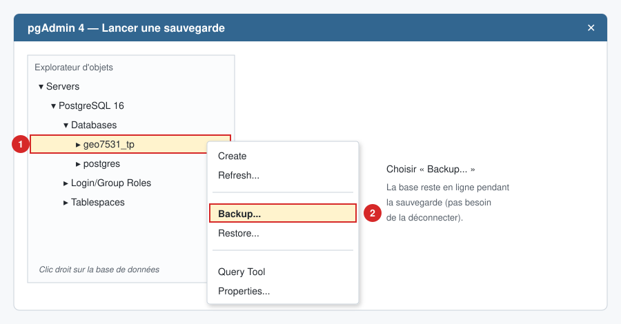
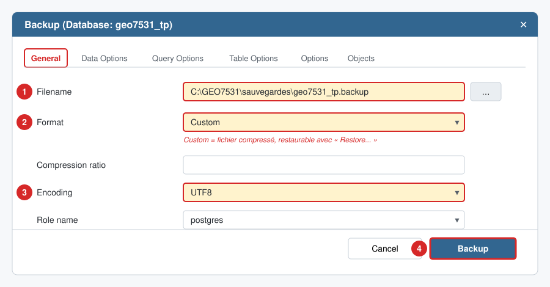
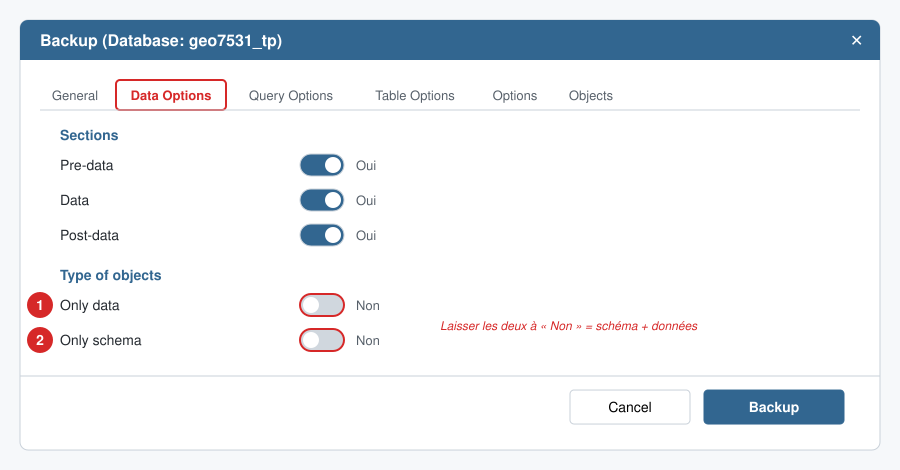
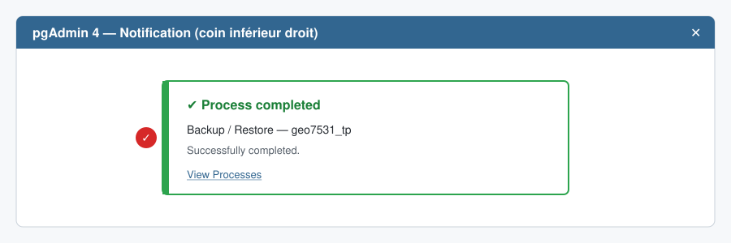
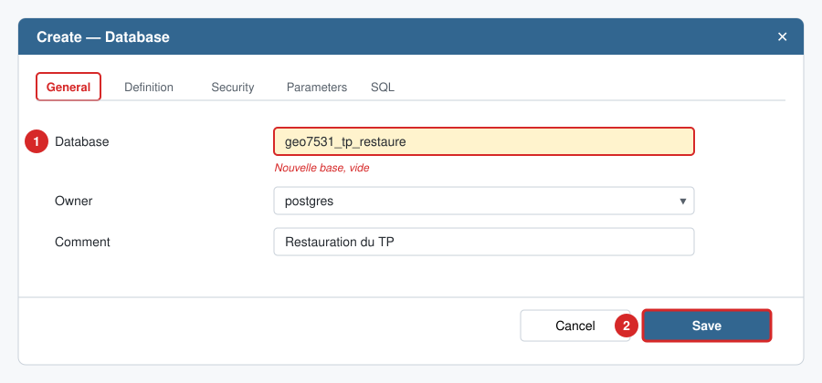
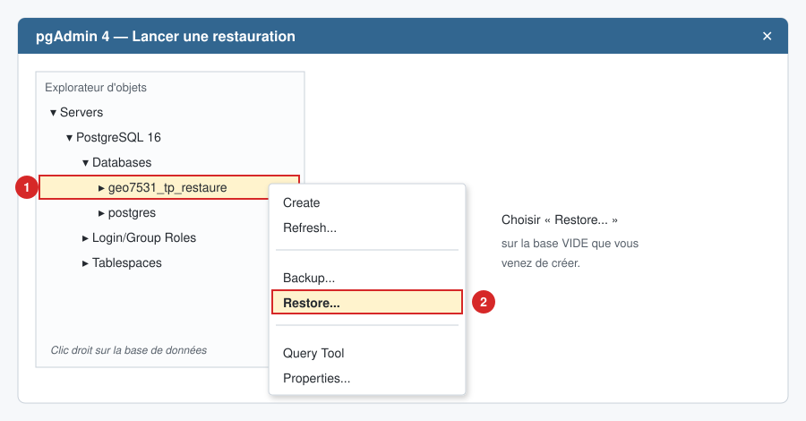
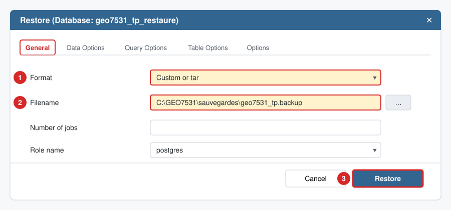
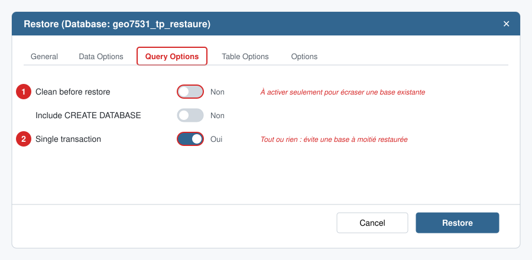

# GEO7531 — Sauvegarder et restaurer une base de données PostgreSQL / PostGIS avec pgAdmin 4

Ce guide explique comment **sauvegarder** (*backup*) une base de données et comment la **restaurer** (*restore*) avec pgAdmin 4. On l'utilise par exemple pour remettre un TP, changer d'ordinateur ou se protéger d'une erreur de manipulation.

> **Note sur les images :** les illustrations sont des schémas simplifiés de l'interface de pgAdmin 4 (version 8 et plus). Selon votre version, la disposition peut varier légèrement. Les numéros rouges indiquent l'ordre des actions.

---

## Table des matières

1. [Avant de commencer](#1-avant-de-commencer)
2. [Sauvegarder une base de données](#2-sauvegarder-une-base-de-données-backup)
3. [Restaurer une base de données](#3-restaurer-une-base-de-données-restore)
4. [Alternative en ligne de commande](#4-alternative-en-ligne-de-commande)
5. [Problèmes fréquents](#5-problèmes-fréquents)

---

## 1. Avant de commencer

- PostgreSQL et pgAdmin 4 sont installés, et vous êtes connecté au serveur dans pgAdmin.
- Créez un dossier pour vos sauvegardes, par exemple `C:\GEO7531\sauvegardes\`.
  Évitez les accents et les espaces dans les chemins : c'est une source d'erreurs fréquente.
- Dans ce guide, la base d'exemple s'appelle `geo7531_tp`. Remplacez-la par le nom de votre base.

### Quel format choisir ?

| Format | Extension | Restaurable avec « Restore... » | Usage recommandé |
|---|---|---|---|
| **Custom** | `.backup` | ✅ Oui | **Format par défaut pour le cours** : compressé et flexible |
| Tar | `.tar` | ✅ Oui | Archive standard |
| Plain | `.sql` | ❌ Non (à exécuter dans le *Query Tool* ou avec `psql`) | Lire ou modifier le SQL à la main |
| Directory | dossier | ✅ Oui | Très grosses bases |

---

## 2. Sauvegarder une base de données (*Backup*)

### Étape 2.1 — Ouvrir la fenêtre de sauvegarde

Dans l'explorateur d'objets à gauche, dépliez **Servers → PostgreSQL → Databases**.
Faites un **clic droit** sur votre base (①), puis choisissez **Backup...** (②).



### Étape 2.2 — Onglet *General*

1. **Filename** : cliquez sur le bouton `…` et choisissez le dossier et le nom du fichier, par exemple `geo7531_tp.backup`.
2. **Format** : choisissez **Custom**.
3. **Encoding** : choisissez **UTF8** (important pour les accents dans les noms de lieux).
4. Cliquez sur **Backup**.



### Étape 2.3 — (Facultatif) Onglet *Data Options*

Par défaut, pgAdmin sauvegarde **la structure** (tables, vues, index) **et les données**. Ne changez rien si vous voulez une copie complète.

- **Only schema** : seulement la structure, sans les données (utile pour partager un modèle de base vide).
- **Only data** : seulement les données.



### Étape 2.4 — Vérifier que la sauvegarde a réussi

Une notification apparaît en bas à droite. Cliquez sur **View Processes** pour voir le détail en cas d'erreur.
Vérifiez ensuite dans votre explorateur de fichiers que le fichier `.backup` existe et qu'il n'est pas vide (0 Ko).



---

## 3. Restaurer une base de données (*Restore*)

> ⚠️ **Règle d'or :** restaurez dans une **nouvelle base vide**. Restaurer par-dessus une base existante peut créer des doublons ou des erreurs de conflit.

### Étape 3.1 — Créer une base vide

Clic droit sur **Databases → Create → Database...**

1. **Database** : donnez un nom, par exemple `geo7531_tp_restaure`.
2. Cliquez sur **Save**.



### Étape 3.2 — Activer PostGIS dans la nouvelle base (si votre base contient des géométries)

Si la base d'origine utilisait PostGIS, ouvrez le **Query Tool** sur la nouvelle base (clic droit → *Query Tool*) et exécutez :

```sql
CREATE EXTENSION IF NOT EXISTS postgis;
```

Cliquez sur ▶ (*Execute*) ou appuyez sur **F5**. Cette étape évite les erreurs du type `type "geometry" does not exist`.

### Étape 3.3 — Ouvrir la fenêtre de restauration

Clic droit sur la **nouvelle base vide** (①), puis **Restore...** (②).



### Étape 3.4 — Onglet *General*

1. **Format** : **Custom or tar**.
2. **Filename** : sélectionnez votre fichier `.backup`.
   Dans la fenêtre de sélection, changez le filtre en bas à droite pour **All files** si votre fichier n'apparaît pas.
3. Cliquez sur **Restore**.



### Étape 3.5 — (Facultatif) Options utiles

- **Clean before restore** : supprime les objets existants avant de les recréer. À activer **seulement** si vous restaurez volontairement par-dessus une base existante.
- **Single transaction** : si une erreur survient, rien n'est restauré. Vous évitez ainsi une base à moitié restaurée.



### Étape 3.6 — Vérifier le résultat

1. Attendez la notification **Process completed**.
2. Clic droit sur la base → **Refresh**.
3. Dépliez **Schemas → public → Tables** : vos tables doivent apparaître.
4. Dans le *Query Tool*, vérifiez le contenu :

```sql
-- Nombre de lignes dans une table
SELECT COUNT(*) FROM nom_de_votre_table;

-- Liste des couches géométriques (PostGIS)
SELECT f_table_schema, f_table_name, f_geometry_column, type, srid
FROM geometry_columns;
```

---

## 4. Alternative en ligne de commande

Les mêmes opérations peuvent être faites avec `pg_dump` et `pg_restore`. Des scripts prêts à l'emploi se trouvent dans le dossier [`scripts/`](scripts/) :

| Script | Système | Rôle |
|---|---|---|
| [`sauvegarde.bat`](scripts/sauvegarde.bat) | Windows | Sauvegarde une base dans un fichier `.backup` horodaté |
| [`restauration.bat`](scripts/restauration.bat) | Windows | Crée une base vide, active PostGIS et restaure le fichier |
| [`sauvegarde.sh`](scripts/sauvegarde.sh) | macOS / Linux | Équivalent de `sauvegarde.bat` |
| [`restauration.sh`](scripts/restauration.sh) | macOS / Linux | Équivalent de `restauration.bat` |

Commandes de base :

```bash
# Sauvegarde (format Custom)
pg_dump -h localhost -p 5432 -U postgres -F c -E UTF8 -f geo7531_tp.backup geo7531_tp

# Restauration dans une base vide
createdb -h localhost -p 5432 -U postgres geo7531_tp_restaure
psql -h localhost -p 5432 -U postgres -d geo7531_tp_restaure -c "CREATE EXTENSION IF NOT EXISTS postgis;"
pg_restore -h localhost -p 5432 -U postgres -d geo7531_tp_restaure --no-owner --single-transaction geo7531_tp.backup

# Restauration d'un fichier .sql (format Plain)
psql -h localhost -p 5432 -U postgres -d geo7531_tp_restaure -f geo7531_tp.sql
```

---

## 5. Problèmes fréquents

| Message ou symptôme | Cause probable | Solution |
|---|---|---|
| `Please configure the PostgreSQL Binary Path in the Preferences dialog` | pgAdmin ne trouve pas `pg_dump` / `pg_restore` | **File → Preferences → Paths → Binary paths**. Pour votre version de PostgreSQL, indiquez le dossier `bin`, par exemple `C:\Program Files\PostgreSQL\16\bin`, puis cliquez sur **Save** |
| Le bouton **Restore** est grisé ou le fichier n'apparaît pas | Mauvais format ou filtre de fichiers | Format **Custom or tar** et filtre **All files** |
| `input file appears to be a text format dump. Please use psql.` | Le fichier est un `.sql` (format Plain) | Ouvrez le fichier dans le **Query Tool** et exécutez-le, ou utilisez `psql -f` |
| `type "geometry" does not exist` | PostGIS n'est pas activé dans la base cible | Exécutez `CREATE EXTENSION postgis;` avant la restauration (étape 3.2) |
| `role "xxx" does not exist` | La sauvegarde vient d'un autre ordinateur ou utilisateur | Onglet **Data Options** de la restauration : activez **Owner** sous *Do not save* (équivaut à `--no-owner`) |
| `unsupported version (1.xx) in file header` | Le fichier a été créé avec une version de PostgreSQL **plus récente** que la vôtre | Mettez à jour PostgreSQL, ou demandez une sauvegarde au format **Plain** (`.sql`) |
| `permission denied` sur le fichier | Le serveur ne peut pas lire ou écrire dans le dossier | Utilisez un dossier simple comme `C:\GEO7531\sauvegardes\` et évitez *Bureau* ou *OneDrive* |
| Erreurs `already exists` | Restauration dans une base qui n'était pas vide | Restaurez dans une nouvelle base vide, ou cochez **Clean before restore** |

---

*Cours GEO7531 — document de consultation. Pour toute question, utilisez le canal habituel du cours.*
