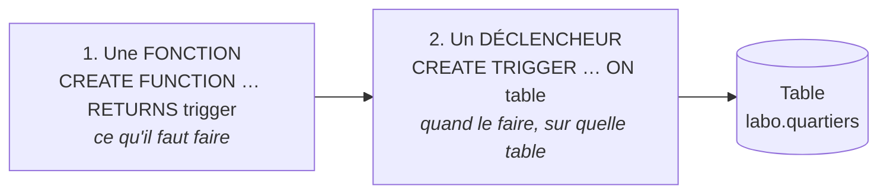
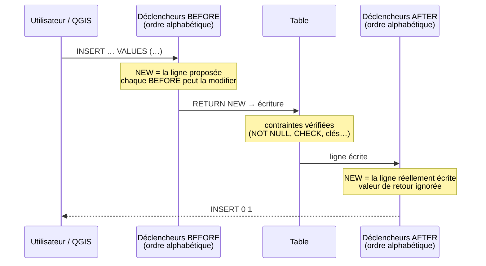

# GEO7531 — Les déclencheurs (triggers) dans PostgreSQL / PostGIS

Un **déclencheur** (*trigger*) est une règle que la base de données applique **toute seule**, à chaque ajout, modification ou suppression de données. Ce tutoriel explique en détail comment ils fonctionnent, puis les applique à des cas concrets de géomatique avec les données NYC du cours : calculer des superficies, faire une jointure spatiale automatique, refuser des coordonnées erronées, tenir un journal des modifications, etc.

> **Pour qui ?** Étudiant·e·s qui connaissent le SQL de base (`SELECT`, `INSERT`, `UPDATE`) et les fonctions spatiales du cours (`ST_Contains`, `ST_Area`, `ST_Transform`…).
> **Prérequis :** une base avec les données NYC restaurées (voir le tutoriel [Créer, restaurer et sauvegarder une base](../README.md)).

---

## Table des matières

0. [Avant de commencer : le bac à sable `labo`](#0-avant-de-commencer--le-bac-à-sable-labo)
1. [Qu'est-ce qu'un déclencheur ?](#1-quest-ce-quun-déclencheur-)
2. [Premier déclencheur, pas à pas](#2-premier-déclencheur-pas-à-pas)
3. [Le vocabulaire complet](#3-le-vocabulaire-complet)
4. [Calculer automatiquement des attributs géométriques](#4-calculer-automatiquement-des-attributs-géométriques)
5. [Une jointure spatiale automatique](#5-une-jointure-spatiale-automatique)
6. [Contrôler la qualité des données](#6-contrôler-la-qualité-des-données)
7. [Un journal des modifications (audit)](#7-un-journal-des-modifications-audit)
8. [Tenir un résumé à jour entre deux tables](#8-tenir-un-résumé-à-jour-entre-deux-tables)
9. [Rendre une vue modifiable : INSTEAD OF](#9-rendre-une-vue-modifiable--instead-of)
10. [Lister, désactiver, modifier, déboguer](#10-lister-désactiver-modifier-déboguer)
11. [Pièges et bonnes pratiques](#11-pièges-et-bonnes-pratiques)
12. [Exercices](#12-exercices)
13. [Aide-mémoire](#13-aide-mémoire)
14. [Références](#14-références)

Scripts du dossier [`scripts/`](scripts/), à exécuter dans l'ordre :

| Script | Section | Contenu |
|---|---|---|
| [`00_preparer_labo.sql`](scripts/00_preparer_labo.sql) | 0 | Copies des tables NYC dans le schéma `labo` |
| [`01_premier_declencheur.sql`](scripts/01_premier_declencheur.sql) | 2 | Horodater chaque modification |
| [`02_calculs_geometriques.sql`](scripts/02_calculs_geometriques.sql) | 4 | Superficie et périmètre calculés automatiquement |
| [`03_jointure_automatique.sql`](scripts/03_jointure_automatique.sql) | 5 | Signalements : quartier et station la plus proche remplis seuls |
| [`04_validation.sql`](scripts/04_validation.sql) | 6 | Refuser, ignorer ou réparer des données |
| [`05_journal_audit.sql`](scripts/05_journal_audit.sql) | 7 | Journal : qui a modifié quoi, quand |
| [`06_resume_a_jour.sql`](scripts/06_resume_a_jour.sql) | 8 | Nombre de stations par quartier tenu à jour |
| [`07_vue_instead_of.sql`](scripts/07_vue_instead_of.sql) | 9 | Écrire dans une vue en longitude / latitude |
| [`08_gerer_deboguer.sql`](scripts/08_gerer_deboguer.sql) | 10 | Lister, désactiver, `WHEN`, `RAISE NOTICE` |
| [`09_exercices_solutions.sql`](scripts/09_exercices_solutions.sql) | 12 | Solutions des exercices |
| [`99_nettoyer.sql`](scripts/99_nettoyer.sql) | — | Tout effacer et recommencer |

---

## 0. Avant de commencer : le bac à sable `labo`

Un déclencheur modifie des données **à votre place**. Pour ne jamais abîmer les tables du cours, tout le tutoriel travaille sur des **copies** placées dans un schéma `labo`.

1. Dans pgAdmin, ouvrez le **Query Tool** sur la base qui contient les données NYC.
2. Exécutez [`scripts/00_preparer_labo.sql`](scripts/00_preparer_labo.sql) :

```sql
CREATE SCHEMA IF NOT EXISTS labo;

CREATE TABLE labo.quartiers AS
SELECT name, boroname, geom::geometry(MultiPolygon, 26918) AS geom
FROM public.nyc_neighborhoods;
ALTER TABLE labo.quartiers ADD COLUMN id serial PRIMARY KEY;

CREATE TABLE labo.stations AS
SELECT name, routes, geom::geometry(Point, 26918) AS geom
FROM public.nyc_subway_stations;
ALTER TABLE labo.stations ADD COLUMN id serial PRIMARY KEY;
```

3. Exécutez ensuite les scripts 01 à 09 dans l'ordre, **une requête à la fois** (sélectionnez-la, puis F5) : vous verrez l'effet de chaque déclencheur.

Pour tout recommencer : [`99_nettoyer.sql`](scripts/99_nettoyer.sql) (`DROP SCHEMA labo CASCADE;`), puis le script 00.

> ℹ️ Dans pgAdmin, les déclencheurs d'une table apparaissent sous **Schemas → labo → Tables → *table* → Triggers**, et leurs fonctions sous **Schemas → labo → Trigger Functions**.

---

## 1. Qu'est-ce qu'un déclencheur ?

### L'idée

Pensez à une **lumière à détecteur de mouvement** : on ne l'allume jamais soi-même. On a réglé une fois pour toutes une règle — *quand quelqu'un passe, allume* — et elle s'applique ensuite automatiquement, à chaque passage.

Un déclencheur, c'est la même chose pour une table :

> **QUAND** une ligne est ajoutée, modifiée ou supprimée **DANS** cette table, **ALORS** exécute cette fonction.

Peu importe d'où vient la modification : une requête dans pgAdmin, un point dessiné dans QGIS, un chargement avec `shp2pgsql` ou `ogr2ogr`, une application Web. **La règle s'applique toujours**, sans que personne n'ait à y penser.

### À quoi ça sert en géomatique ?

| Besoin | Sans déclencheur | Avec déclencheur |
|---|---|---|
| Superficie d'un polygone à jour | Penser à refaire `UPDATE … SET aire = ST_Area(geom)` après chaque modification | Recalculée à chaque modification de la géométrie |
| Quartier d'un point saisi dans QGIS | Jointure spatiale manuelle après coup | Rempli au moment de la saisie |
| Coordonnées inversées, point hors du territoire | Erreur découverte des semaines plus tard | Saisie refusée immédiatement, avec un message clair |
| Savoir qui a modifié une parcelle, et l'ancienne géométrie | Impossible | Journal complet, automatique |
| Saisir des points en lat/lon dans une table en UTM | Conversion manuelle | Conversion faite par la base |

### Les deux pièces d'un déclencheur

Dans PostgreSQL, un déclencheur se crée toujours en **deux étapes** :



1. **La fonction** contient le travail à faire. Elle est écrite en **PL/pgSQL**, le langage de programmation de PostgreSQL (des `IF`, des variables, des requêtes SQL). Elle retourne le type spécial `trigger`.
2. **Le déclencheur** relie cette fonction à une table et dit **quand** l'appeler : avant ou après, pour quelles opérations.

Une même fonction peut servir à plusieurs déclencheurs, sur plusieurs tables (voir le journal, section 7).

---

## 2. Premier déclencheur, pas à pas

Objectif : chaque fois qu'un quartier est ajouté ou modifié, noter **quand** et **par qui**, sans que l'utilisateur ait à le faire.

Script : [`01_premier_declencheur.sql`](scripts/01_premier_declencheur.sql)

**Étape 1 — Les colonnes à remplir**

```sql
ALTER TABLE labo.quartiers
  ADD COLUMN IF NOT EXISTS modifie_le  timestamptz,
  ADD COLUMN IF NOT EXISTS modifie_par text;
```

**Étape 2 — La fonction**

```sql
CREATE OR REPLACE FUNCTION labo.f_horodater()
RETURNS trigger
LANGUAGE plpgsql
AS $$
BEGIN
  NEW.modifie_le  := now();
  NEW.modifie_par := current_user;
  RETURN NEW;
END;
$$;
```

Ligne par ligne :

| Ligne | Signification |
|---|---|
| `RETURNS trigger` | Ce n'est pas une fonction ordinaire : elle ne peut être appelée que par un déclencheur |
| `LANGUAGE plpgsql` | Le corps est écrit en PL/pgSQL |
| `AS $$ … $$` | Le code de la fonction, entre deux `$$` (cela évite de doubler les apostrophes à l'intérieur) |
| `NEW` | **La ligne telle qu'elle va être écrite.** On peut lire et modifier ses colonnes : `NEW.name`, `NEW.geom`… |
| `:=` | Affectation en PL/pgSQL (« prend la valeur ») |
| `now()`, `current_user` | Date et heure de la transaction, et nom de l'utilisateur connecté |
| `RETURN NEW` | « Continue, et écris **cette** version de la ligne », avec nos modifications |

**Étape 3 — Le déclencheur**

```sql
CREATE TRIGGER trg_quartiers_horodater
  BEFORE INSERT OR UPDATE            -- avant l'écriture, à l'ajout ou à la modification
  ON labo.quartiers                  -- sur cette table
  FOR EACH ROW                       -- une fois par ligne touchée
  EXECUTE FUNCTION labo.f_horodater();
```

**Étape 4 — Essayer**

```sql
UPDATE labo.quartiers SET name = 'SoHo' WHERE name = 'Soho';

SELECT id, name, modifie_le, modifie_par
FROM labo.quartiers WHERE name = 'SoHo';
```

`modifie_le` et `modifie_par` sont remplis, alors que l'`UPDATE` ne les mentionne pas : c'est le déclencheur.

> 💡 **Convention de nommage** utilisée ici : `f_…` pour les fonctions, `trg_table_action` pour les déclencheurs. Le nom du déclencheur compte : quand plusieurs déclencheurs réagissent au même événement, ils s'exécutent **par ordre alphabétique** (section 3.5).

> ℹ️ `EXECUTE FUNCTION` existe depuis PostgreSQL 11. Dans les anciens tutoriels, vous verrez `EXECUTE PROCEDURE` : c'est la même chose.

---

## 3. Le vocabulaire complet

### 3.1 Anatomie de `CREATE TRIGGER`

```sql
CREATE TRIGGER nom_du_declencheur
  { BEFORE | AFTER | INSTEAD OF }                        -- le MOMENT
  { INSERT | UPDATE [ OF colonne, … ] | DELETE | TRUNCATE } [ OR … ]   -- l'ÉVÉNEMENT
  ON nom_de_la_table
  [ FOR EACH { ROW | STATEMENT } ]                       -- le NIVEAU
  [ WHEN ( condition ) ]                                  -- la CONDITION (facultatif)
  EXECUTE FUNCTION nom_de_la_fonction();
```

### 3.2 Le moment : BEFORE, AFTER ou INSTEAD OF

| Moment | Quand ? | Peut modifier la ligne ? | Peut annuler ? | Usages typiques |
|---|---|---|---|---|
| **BEFORE** | Avant l'écriture de la ligne | **Oui** (en modifiant `NEW`) | Oui (`RETURN NULL` ou erreur) | Calculer une superficie, remplir un quartier, valider, corriger |
| **AFTER** | Après l'écriture de la ligne | Non (trop tard) | Seulement par une erreur | Journal, mise à jour d'**autres** tables, résumés |
| **INSTEAD OF** | **À la place** de l'opération (vues seulement) | — | — | Rendre une vue modifiable |

> 🧭 **Règle simple :** pour modifier la ligne elle-même → **BEFORE**. Pour réagir à ce qui a été écrit, dans une autre table → **AFTER**.

### 3.3 L'événement

`INSERT`, `UPDATE`, `DELETE`, `TRUNCATE`, que l'on combine avec `OR` : `BEFORE INSERT OR UPDATE`.

`UPDATE OF geom` restreint le déclencheur aux `UPDATE` dont le `SET` mentionne la colonne `geom` : renommer un quartier ne recalcule pas sa superficie.

### 3.4 Le niveau : ROW ou STATEMENT

| | `FOR EACH ROW` | `FOR EACH STATEMENT` (par défaut) |
|---|---|---|
| Exécuté | **Une fois par ligne** touchée | **Une fois par requête**, même si elle touche 0 ou 10 000 lignes |
| Accès à `NEW` / `OLD` | Oui | Non |
| Usage | Presque tous les cas de ce tutoriel | Journaliser « une requête a eu lieu », rafraîchir une vue matérialisée |

Un `UPDATE labo.quartiers SET geom = geom` touche 129 lignes : un déclencheur `FOR EACH ROW` s'exécute 129 fois.

### 3.5 Ce qui se passe pendant un `INSERT`



- Les déclencheurs `BEFORE` s'enchaînent : chacun reçoit le `NEW` modifié par le précédent.
- Si un `BEFORE` renvoie `NULL`, la ligne n'est **pas** écrite, et les déclencheurs suivants ne sont pas appelés pour elle.
- Si **n'importe quel** déclencheur lève une erreur, **toute la requête est annulée** : aucune ligne n'est écrite, même celles qui étaient valides (section 6).
- Plusieurs déclencheurs sur le même événement s'exécutent **par ordre alphabétique de nom**. Pour imposer un ordre, numérotez-les : `trg_signalements_1_completer`, `trg_signalements_2_valider`.

### 3.6 Les variables disponibles dans la fonction

| Variable | Contenu |
|---|---|
| `NEW` | La nouvelle ligne : `INSERT` et `UPDATE`. **NULL** pour `DELETE` |
| `OLD` | L'ancienne ligne : `UPDATE` et `DELETE`. **NULL** pour `INSERT` |
| `TG_OP` | L'opération : `'INSERT'`, `'UPDATE'`, `'DELETE'` ou `'TRUNCATE'` |
| `TG_WHEN` | `'BEFORE'`, `'AFTER'` ou `'INSTEAD OF'` |
| `TG_LEVEL` | `'ROW'` ou `'STATEMENT'` |
| `TG_NAME` | Le nom du déclencheur |
| `TG_TABLE_NAME`, `TG_TABLE_SCHEMA` | La table et son schéma (utile pour une fonction partagée entre plusieurs tables) |
| `TG_ARGV[]` | Les arguments passés dans `EXECUTE FUNCTION f('arg1', 'arg2')` |

Pendant un `UPDATE`, comparer `OLD` et `NEW` permet de savoir **ce qui a changé** : `IF NEW.geom IS DISTINCT FROM OLD.geom THEN …`

### 3.7 Que doit retourner la fonction ?

C'est **la** source d'erreurs la plus fréquente.

| Déclencheur | `RETURN NEW` | `RETURN OLD` | `RETURN NULL` |
|---|---|---|---|
| `BEFORE INSERT` / `BEFORE UPDATE` | ✅ Écrire la ligne (éventuellement modifiée) | — | ⚠️ **Annule en silence** l'opération pour cette ligne |
| `BEFORE DELETE` | — | ✅ Laisser la suppression se faire | ⚠️ Annule la suppression en silence |
| `AFTER …` (tous) | Ignoré | Ignoré | ✅ Convention habituelle |
| `INSTEAD OF` | ✅ L'opération est considérée comme faite | ✅ (pour `DELETE`) | La ligne est comptée comme non traitée |
| `FOR EACH STATEMENT` | — | — | ✅ Toujours `NULL` |

> ⚠️ Oublier le `RETURN` provoque l'erreur `control reached end of trigger procedure without RETURN`.
> ⚠️ Un `BEFORE DELETE` qui fait `RETURN NEW` annule la suppression sans erreur, car `NEW` vaut `NULL` pour un `DELETE`. Pour un `DELETE`, retournez `OLD`.

---

## 4. Calculer automatiquement des attributs géométriques

Script : [`02_calculs_geometriques.sql`](scripts/02_calculs_geometriques.sql)

La superficie et le périmètre de chaque quartier sont recalculés **dès que la géométrie change** : modification de sommets dans QGIS, simplification, correction…

```sql
ALTER TABLE labo.quartiers
  ADD COLUMN IF NOT EXISTS superficie_km2 numeric(10, 3),
  ADD COLUMN IF NOT EXISTS perimetre_km   numeric(10, 3);

CREATE OR REPLACE FUNCTION labo.f_quartiers_mesurer()
RETURNS trigger
LANGUAGE plpgsql
AS $$
BEGIN
  NEW.superficie_km2 := ST_Area(NEW.geom) / 1e6;        -- m² → km²
  NEW.perimetre_km   := ST_Perimeter(NEW.geom) / 1e3;   -- m  → km
  RETURN NEW;
END;
$$;

CREATE TRIGGER trg_quartiers_mesurer
  BEFORE INSERT OR UPDATE OF geom      -- seulement si geom est modifiée
  ON labo.quartiers
  FOR EACH ROW
  EXECUTE FUNCTION labo.f_quartiers_mesurer();
```

**Un déclencheur n'agit que sur les opérations futures.** Les 129 quartiers existants n'ont pas encore de superficie : on les « réveille » en réécrivant leur géométrie à l'identique.

```sql
UPDATE labo.quartiers SET geom = geom;
```

Essai : simplifier Central Park avec une tolérance de 50 m. La superficie et le périmètre suivent :

```sql
UPDATE labo.quartiers
SET geom = ST_Multi(ST_Simplify(geom, 50))
WHERE name = 'Central Park';

SELECT name, superficie_km2, perimetre_km
FROM labo.quartiers WHERE name = 'Central Park';
```

> 💡 **Alternative : la colonne générée** (PostgreSQL 12 et plus).
> ```sql
> ALTER TABLE labo.quartiers
>   ADD COLUMN superficie_km2_gen numeric
>   GENERATED ALWAYS AS (ST_Area(geom) / 1e6) STORED;
> ```
> Plus simple, mais limitée : le calcul ne peut utiliser **que les colonnes de la ligne elle-même**. Dès qu'il faut consulter une **autre table** (dans quel quartier se trouve ce point ?), il faut un déclencheur.

---

## 5. Une jointure spatiale automatique

Script : [`03_jointure_automatique.sql`](scripts/03_jointure_automatique.sql)

**Scénario.** Une application citoyenne enregistre des signalements (nid-de-poule, lampadaire brisé…). L'utilisateur ne donne qu'une description et une position, en longitude/latitude depuis son téléphone, ou en dessinant un point dans QGIS. La base complète tout le reste :

- la géométrie en UTM 18N (ou, à l'inverse, la longitude et la latitude) ;
- le **quartier** et l'**arrondissement** (jointure spatiale `ST_Contains`) ;
- la **station de métro la plus proche** et sa distance (plus proche voisin `<->`).

```sql
CREATE TABLE labo.signalements (
  id              serial PRIMARY KEY,
  description     text NOT NULL,
  lon             double precision,
  lat             double precision,
  geom            geometry(Point, 26918),
  quartier        text,
  arrondissement  text,
  station_proche  text,
  dist_station_m  integer,
  cree_le         timestamptz DEFAULT now()
);
```

Le cœur de la fonction (version complète dans le script) :

```sql
-- Construire la géométrie à partir de lon/lat
NEW.geom := ST_Transform(ST_SetSRID(ST_MakePoint(NEW.lon, NEW.lat), 4326), 26918);

-- Jointure spatiale : SELECT … INTO remplit directement les champs de NEW
SELECT q.name, q.boroname
  INTO NEW.quartier, NEW.arrondissement
FROM labo.quartiers AS q
WHERE ST_Contains(q.geom, NEW.geom)
LIMIT 1;

-- Plus proche voisin
SELECT s.name, round(ST_Distance(s.geom, NEW.geom))
  INTO NEW.station_proche, NEW.dist_station_m
FROM labo.stations AS s
ORDER BY s.geom <-> NEW.geom
LIMIT 1;

RETURN NEW;
```

Essai :

```sql
INSERT INTO labo.signalements (description, lon, lat) VALUES
  ('Nid-de-poule devant l''Empire State Building', -73.9857, 40.7484),
  ('Lampadaire brisé près du Yankee Stadium',     -73.9262, 40.8296);

SELECT description, quartier, arrondissement, station_proche, dist_station_m
FROM labo.signalements;
```

Le `SELECT … INTO` ne trouve parfois aucune ligne, par exemple pour un point dans l'eau. Les champs restent alors `NULL`, sans erreur. La section 6 montre comment refuser ces cas.

> 🗺️ **Avec QGIS.** Ajoutez `labo.signalements` dans QGIS, passez en mode édition, dessinez un point, saisissez seulement la description et enregistrez. Rouvrez la table attributaire : quartier, station et coordonnées sont remplis. **QGIS n'a rien calculé, c'est PostgreSQL.** Le même déclencheur fonctionne pour toute application qui écrit dans la table.

> ⚠️ **Coût.** Ce déclencheur fait deux requêtes spatiales **par ligne insérée**. Pour un formulaire, c'est instantané. Pour un chargement de 100 000 points, voir la section 11.

---

## 6. Contrôler la qualité des données

Script : [`04_validation.sql`](scripts/04_validation.sql)

Trois stratégies, à choisir selon la gravité du problème :

| Stratégie | Code | Effet | Quand l'utiliser |
|---|---|---|---|
| **Refuser** | `RAISE EXCEPTION '…'` | Erreur ; **toute la requête est annulée** | Donnée manifestement fausse : hors du territoire, coordonnées inversées |
| **Ignorer** | `RETURN NULL` dans un `BEFORE` | La ligne n'est pas écrite, **sans erreur** | Doublons d'un flux automatique (capteurs, GPS) |
| **Réparer** | Modifier `NEW`, puis `RETURN NEW` | La ligne est corrigée puis écrite | Géométrie invalide réparable avec `ST_MakeValid` |

### 6.1 Refuser avec un message clair

```sql
CREATE OR REPLACE FUNCTION labo.f_signalements_valider()
RETURNS trigger
LANGUAGE plpgsql
AS $$
BEGIN
  IF NEW.quartier IS NULL THEN
    RAISE EXCEPTION 'Le point (%, %) est hors des quartiers de New York', NEW.lon, NEW.lat
      USING HINT = 'Vérifiez l''ordre : ST_MakePoint(longitude, latitude).';
  END IF;
  RETURN NEW;
END;
$$;

CREATE TRIGGER trg_signalements_2_valider     -- « 2 » : après trg_signalements_1_completer
  BEFORE INSERT OR UPDATE ON labo.signalements
  FOR EACH ROW EXECUTE FUNCTION labo.f_signalements_valider();
```

Dans `RAISE`, chaque `%` est remplacé par la valeur suivante. Le `HINT` s'affiche sous le message d'erreur dans pgAdmin et dans QGIS.

```sql
INSERT INTO labo.signalements (description, lon, lat)
VALUES ('Coordonnées inversées', 40.7484, -73.9857);
-- ERREUR:  Le point (40.7484, -73.9857) est hors des quartiers de New York
-- ASTUCE : Vérifiez l'ordre : ST_MakePoint(longitude, latitude).
```

**Tout ou rien.** Un `INSERT` de deux lignes, l'une à Times Square et l'autre à Montréal, est refusé **en entier** : aucune des deux lignes n'est ajoutée. La requête est une transaction.

### 6.2 Ignorer en silence

```sql
-- Même description à moins de 10 m d'un signalement existant : on ignore
IF EXISTS (SELECT 1 FROM labo.signalements AS s
           WHERE s.description = NEW.description
             AND ST_DWithin(s.geom, NEW.geom, 10)) THEN
  RAISE NOTICE 'Doublon ignoré : « % »', NEW.description;
  RETURN NULL;
END IF;
RETURN NEW;
```

Le second envoi affiche `INSERT 0 0`, c'est-à-dire aucune ligne insérée, et un avertissement dans l'onglet **Messages**. À utiliser avec prudence : une application qui ne lit pas les avertissements ne saura pas que la ligne a été écartée.

### 6.3 Réparer

```sql
IF NOT ST_IsValid(NEW.geom) THEN
  RAISE NOTICE 'Quartier « % » : géométrie invalide (%), réparée',
               NEW.name, ST_IsValidReason(NEW.geom);
  NEW.geom := ST_Multi(ST_CollectionExtract(ST_MakeValid(NEW.geom), 3));
END IF;
RETURN NEW;
```

Ce déclencheur s'appelle `trg_quartiers_a_reparer` : le « a » le fait passer **avant** `trg_quartiers_mesurer`. On répare d'abord, on mesure ensuite.

> 💡 **Alternative : la contrainte `CHECK`.** Pour une règle qui ne dépend que de la ligne elle-même, une contrainte suffit et se lit mieux :
> `ALTER TABLE labo.stations ADD CONSTRAINT stations_geom_valide CHECK (ST_IsValid(geom));`
> Le déclencheur devient nécessaire pour **consulter une autre table** (le point est-il dans un quartier ?), **corriger** au lieu de refuser, ou écrire un **message personnalisé**.

---

## 7. Un journal des modifications (audit)

Script : [`05_journal_audit.sql`](scripts/05_journal_audit.sql)

**Qui** a modifié **quoi**, **quand**, et quelle était la valeur **avant** ? Indispensable pour un cadastre, un réseau d'aqueduc, ou toute donnée éditée par plusieurs personnes.

```sql
CREATE TABLE labo.journal (
  id          bigserial PRIMARY KEY,
  quand       timestamptz NOT NULL DEFAULT now(),
  qui         text        NOT NULL DEFAULT current_user,
  table_nom   text        NOT NULL,
  operation   text        NOT NULL,
  avant       jsonb,          -- attributs avant
  apres       jsonb,          -- attributs après
  geom_avant  geometry,
  geom_apres  geometry
);

CREATE OR REPLACE FUNCTION labo.f_journaliser()
RETURNS trigger
LANGUAGE plpgsql
AS $$
DECLARE
  v_avant jsonb;
  v_apres jsonb;
BEGIN
  IF TG_OP IN ('UPDATE', 'DELETE') THEN
    v_avant := to_jsonb(OLD) - 'geom';   -- toute la ligne en JSON, sauf la géométrie
  END IF;
  IF TG_OP IN ('INSERT', 'UPDATE') THEN
    v_apres := to_jsonb(NEW) - 'geom';
  END IF;

  INSERT INTO labo.journal (table_nom, operation, avant, apres, geom_avant, geom_apres)
  VALUES (TG_TABLE_SCHEMA || '.' || TG_TABLE_NAME, TG_OP, v_avant, v_apres,
          CASE WHEN TG_OP <> 'INSERT' THEN OLD.geom END,
          CASE WHEN TG_OP <> 'DELETE' THEN NEW.geom END);
  RETURN NULL;
END;
$$;

CREATE TRIGGER trg_stations_journal
  AFTER INSERT OR UPDATE OR DELETE ON labo.stations
  FOR EACH ROW EXECUTE FUNCTION labo.f_journaliser();
```

Pourquoi ce code fonctionne :

- **AFTER** : on enregistre ce qui a **réellement** été écrit, après les corrections des `BEFORE`. Si un `BEFORE` refuse la ligne, rien n'est journalisé.
- **`to_jsonb(OLD)`** transforme toute la ligne en objet JSON, quelles que soient ses colonnes. La **même fonction** peut donc servir sur n'importe quelle table : le script l'attache aussi à `labo.quartiers`.
- **`TG_TABLE_NAME`** indique la table qui a déclenché la fonction.

Interroger le journal, par exemple la distance de déplacement d'une station :

```sql
SELECT quand, qui, operation,
       avant ->> 'name' AS nom_avant,
       apres ->> 'name' AS nom_apres,
       round(ST_Distance(geom_avant, geom_apres)) AS deplacement_m
FROM labo.journal
ORDER BY id;
```

---

## 8. Tenir un résumé à jour entre deux tables

Script : [`06_resume_a_jour.sql`](scripts/06_resume_a_jour.sql)

Chaque quartier affiche son nombre de stations. Quand une station est **ajoutée, déplacée ou supprimée**, le décompte du quartier concerné se met à jour seul.

```sql
CREATE OR REPLACE FUNCTION labo.f_stations_recompter()
RETURNS trigger
LANGUAGE plpgsql
AS $$
DECLARE
  g_ancienne geometry;
  g_nouvelle geometry;
BEGIN
  IF TG_OP IN ('UPDATE', 'DELETE') THEN g_ancienne := OLD.geom; END IF;
  IF TG_OP IN ('INSERT', 'UPDATE') THEN g_nouvelle := NEW.geom; END IF;

  -- On ne recompte que le ou les quartiers concernés, pas les 129
  UPDATE labo.quartiers AS q
  SET nb_stations = (SELECT count(*) FROM labo.stations AS s
                     WHERE ST_Contains(q.geom, s.geom))
  WHERE ST_Contains(q.geom, g_ancienne)
     OR ST_Contains(q.geom, g_nouvelle);
  RETURN NULL;
END;
$$;

CREATE TRIGGER trg_stations_recompter
  AFTER INSERT OR DELETE OR UPDATE OF geom ON labo.stations
  FOR EACH ROW EXECUTE FUNCTION labo.f_stations_recompter();
```

- **AFTER**, car la station doit déjà être écrite ou effacée pour être comptée correctement.
- Une station **déplacée** d'un quartier à un autre modifie **deux** quartiers : celui qu'elle quitte (`OLD.geom`) et celui où elle arrive (`NEW.geom`).

**Cascade.** L'`UPDATE` de `labo.quartiers` fait par ce déclencheur réveille à son tour les déclencheurs de `labo.quartiers` : horodatage et journal. C'est voulu ici, mais une cascade mal pensée peut devenir une boucle infinie (section 11).

> 💡 **Alternative : la vue.** Une vue `SELECT q.*, count(s.*) … GROUP BY …` donne toujours le bon décompte, sans déclencheur, mais le recalcule à **chaque lecture**. Le déclencheur calcule une fois, **à l'écriture** : préférable quand la carte est lue bien plus souvent que les données ne changent.

---

## 9. Rendre une vue modifiable : INSTEAD OF

Script : [`07_vue_instead_of.sql`](scripts/07_vue_instead_of.sql)

Une vue présente les stations en **longitude / latitude**, pratique pour un site Web :

```sql
CREATE OR REPLACE VIEW labo.v_stations_wgs84 AS
SELECT id, name, routes,
       round(ST_X(ST_Transform(geom, 4326))::numeric, 6) AS lon,
       round(ST_Y(ST_Transform(geom, 4326))::numeric, 6) AS lat
FROM labo.stations;
```

Essayer d'y insérer une ligne échoue : `cannot insert into column "lon" of view`. PostgreSQL ne sait pas « défaire » un `ST_Transform`. Le déclencheur `INSTEAD OF` lui explique quoi faire **à la place** :

```sql
CREATE OR REPLACE FUNCTION labo.f_v_stations_ecrire()
RETURNS trigger
LANGUAGE plpgsql
AS $$
BEGIN
  IF TG_OP = 'INSERT' THEN
    INSERT INTO labo.stations (name, routes, geom)
    VALUES (NEW.name, NEW.routes,
            ST_Transform(ST_SetSRID(ST_MakePoint(NEW.lon, NEW.lat), 4326), 26918))
    RETURNING id INTO NEW.id;
    RETURN NEW;
  ELSIF TG_OP = 'UPDATE' THEN
    UPDATE labo.stations
    SET name = NEW.name, routes = NEW.routes,
        geom = ST_Transform(ST_SetSRID(ST_MakePoint(NEW.lon, NEW.lat), 4326), 26918)
    WHERE id = OLD.id;
    RETURN NEW;
  ELSE  -- DELETE
    DELETE FROM labo.stations WHERE id = OLD.id;
    RETURN OLD;
  END IF;
END;
$$;

CREATE TRIGGER trg_v_stations_ecrire
  INSTEAD OF INSERT OR UPDATE OR DELETE ON labo.v_stations_wgs84
  FOR EACH ROW EXECUTE FUNCTION labo.f_v_stations_ecrire();
```

```sql
INSERT INTO labo.v_stations_wgs84 (name, routes, lon, lat)
VALUES ('Station Hudson Yards (test)', '7', -74.0021, 40.7553)
RETURNING id;
```

La station est stockée en UTM 18N dans `labo.stations`. Les déclencheurs de la table (journal, recompte) ont réagi eux aussi.

`INSTEAD OF` ne s'utilise **que sur des vues** et toujours `FOR EACH ROW`.

---

## 10. Lister, désactiver, modifier, déboguer

Script : [`08_gerer_deboguer.sql`](scripts/08_gerer_deboguer.sql)

**Lister** les déclencheurs d'un schéma (l'ordre alphabétique est l'ordre d'exécution) :

```sql
SELECT event_object_table AS table_nom, trigger_name, action_timing,
       event_manipulation, action_orientation
FROM information_schema.triggers
WHERE trigger_schema = 'labo'
ORDER BY table_nom, trigger_name;
```

Dans psql, `\d labo.quartiers` affiche les déclencheurs en bas de la description de la table.

**Lire le code** d'une fonction :

```sql
SELECT pg_get_functiondef('labo.f_signalements_completer'::regproc);
```

**Désactiver temporairement**, par exemple pendant un gros chargement :

```sql
ALTER TABLE labo.quartiers DISABLE TRIGGER trg_quartiers_journal;   -- un seul
ALTER TABLE labo.quartiers ENABLE  TRIGGER trg_quartiers_journal;

ALTER TABLE labo.stations DISABLE TRIGGER USER;   -- tous ceux créés par les utilisateurs
ALTER TABLE labo.stations ENABLE  TRIGGER USER;
```

**Modifier :**
- **ce que fait** le déclencheur : `CREATE OR REPLACE FUNCTION`, qui prend effet immédiatement ;
- **quand** il se déclenche : `CREATE OR REPLACE TRIGGER` (PostgreSQL 14 et plus), ou `DROP TRIGGER` puis `CREATE TRIGGER`.

**Condition `WHEN`** : la fonction n'est même pas appelée si la condition est fausse. C'est plus rapide qu'un `IF` au début de la fonction.

```sql
CREATE OR REPLACE TRIGGER trg_quartiers_horodater
  BEFORE UPDATE ON labo.quartiers
  FOR EACH ROW
  WHEN (OLD.* IS DISTINCT FROM NEW.*)   -- seulement si quelque chose change vraiment
  EXECUTE FUNCTION labo.f_horodater();
```

**Déboguer avec `RAISE NOTICE`.** Le message s'affiche dans l'onglet **Messages** de pgAdmin :

```sql
RAISE NOTICE 'Déclencheur % : % % sur % — NEW = %', TG_NAME, TG_WHEN, TG_OP, TG_TABLE_NAME, NEW;
```

**Supprimer :**

```sql
DROP TRIGGER IF EXISTS trg_quartiers_horodater ON labo.quartiers;
DROP FUNCTION IF EXISTS labo.f_horodater();
```

---

## 11. Pièges et bonnes pratiques

| Piège | Ce qui arrive | Comment l'éviter |
|---|---|---|
| **Boucle infinie** | Un `AFTER UPDATE` sur une table fait un `UPDATE` de la **même** table, qui se redéclenche, et ainsi de suite jusqu'à l'erreur `stack depth limit exceeded` | Pour modifier la ligne elle-même, utilisez un `BEFORE` et modifiez `NEW`. Sinon, ajoutez une condition `WHEN` ou testez `pg_trigger_depth()` |
| **`RETURN` oublié ou mauvais** | Erreur `control reached end of trigger procedure without RETURN`, ou opération annulée en silence (`INSERT 0 0`) | Voir le tableau 3.7 : `NEW` pour `INSERT`/`UPDATE`, `OLD` pour `DELETE`, `NULL` pour `AFTER` |
| **Lignes existantes non calculées** | La nouvelle colonne est vide pour les anciennes lignes | Un déclencheur agit sur le futur : faites un `UPDATE … SET geom = geom` une fois |
| **Chargement massif très lent** | `shp2pgsql`, `ogr2ogr` et `COPY` **déclenchent** les déclencheurs `FOR EACH ROW` : 100 000 lignes = 100 000 requêtes spatiales | Désactivez (`DISABLE TRIGGER`), chargez, faites **un seul** `UPDATE` ensemblier, puis réactivez |
| **`TRUNCATE` et journal** | `TRUNCATE` ne déclenche **pas** les déclencheurs `DELETE` : le journal ne voit rien | Utilisez `DELETE`, ou ajoutez un déclencheur `AFTER TRUNCATE … FOR EACH STATEMENT` |
| **`UPDATE OF colonne` mal compris** | Ne réagit qu'aux colonnes **écrites dans le `SET`**, pas à celles modifiées par un autre déclencheur | Retirez `OF colonne` si la colonne peut changer indirectement |
| **Ordre imprévu** | Deux `BEFORE` sur la même table s'exécutent dans un ordre « au hasard » | C'est l'ordre **alphabétique** : numérotez les noms (`trg_x_1_…`, `trg_x_2_…`) |
| **Logique cachée** | Un collègue ne comprend pas pourquoi « sa » valeur est remplacée | Documentez : `COMMENT ON TRIGGER trg_… ON table IS '…';` et nommez clairement |
| **Erreur dans un déclencheur = requête annulée** | Une seule ligne fautive fait échouer l'`INSERT` de 1 000 lignes, ou l'enregistrement d'une couche dans QGIS | C'est voulu (intégrité), mais rédigez des messages `RAISE` explicites avec un `HINT` |

**Bon à savoir :**
- Les déclencheurs s'exécutent avec les droits de l'**utilisateur qui fait la modification** (sauf fonction déclarée `SECURITY DEFINER`).
- Une **sauvegarde** (`pg_dump` / *Backup*) contient les fonctions et déclencheurs. À la **restauration**, les données sont chargées **avant** la création des déclencheurs : ils ne se déclenchent donc pas pendant la restauration.
- Ne mettez dans un déclencheur que ce qui **doit toujours** être vrai, quelle que soit l'application. Un calcul ponctuel, pour une analyse, reste une requête ordinaire.

---

## 12. Exercices

Faites d'abord les scripts 00 à 07. Solutions complètes dans [`09_exercices_solutions.sql`](scripts/09_exercices_solutions.sql).

**Exercice 1 — Protéger la ligne A.** Empêchez la suppression de toute station dont `routes` contient `A`, avec un message d'erreur indiquant le nom de la station.

<details>
<summary>Indice et solution</summary>

`BEFORE DELETE`, `strpos(OLD.routes, 'A') > 0`, `RAISE EXCEPTION`. Attention au `RETURN` d'un `BEFORE DELETE`.

```sql
CREATE OR REPLACE FUNCTION labo.f_proteger_ligne_a()
RETURNS trigger LANGUAGE plpgsql AS $$
BEGIN
  IF strpos(OLD.routes, 'A') > 0 THEN
    RAISE EXCEPTION 'La station % (lignes %) dessert la ligne A : suppression interdite',
                    OLD.name, OLD.routes;
  END IF;
  RETURN OLD;
END;
$$;

CREATE TRIGGER trg_stations_proteger_a
  BEFORE DELETE ON labo.stations
  FOR EACH ROW EXECUTE FUNCTION labo.f_proteger_ligne_a();
```
</details>

**Exercice 2 — Chaque station connaît son quartier.** Ajoutez une colonne `quartier` à `labo.stations`, remplie automatiquement à l'ajout et à chaque déplacement. Remplissez aussi les stations existantes.

<details>
<summary>Indice et solution</summary>

`BEFORE INSERT OR UPDATE OF geom`, `SELECT … INTO NEW.quartier`, puis `UPDATE … SET geom = geom`.

```sql
ALTER TABLE labo.stations ADD COLUMN IF NOT EXISTS quartier text;

CREATE OR REPLACE FUNCTION labo.f_stations_quartier()
RETURNS trigger LANGUAGE plpgsql AS $$
BEGIN
  SELECT q.name INTO NEW.quartier
  FROM labo.quartiers AS q
  WHERE ST_Contains(q.geom, NEW.geom)
  LIMIT 1;
  RETURN NEW;
END;
$$;

CREATE TRIGGER trg_stations_quartier
  BEFORE INSERT OR UPDATE OF geom ON labo.stations
  FOR EACH ROW EXECUTE FUNCTION labo.f_stations_quartier();

UPDATE labo.stations SET geom = geom;
```
</details>

**Exercice 3 — Pas de grands déplacements.** Refusez toute modification qui déplace une station de plus de 100 m. Essayez avec `ST_Translate(geom, 30, 0)` (accepté) puis `ST_Translate(geom, 500, 0)` (refusé).

<details>
<summary>Indice et solution</summary>

`BEFORE UPDATE OF geom`, `ST_Distance(OLD.geom, NEW.geom)`, et une condition `WHEN` pour ne rien faire si la géométrie n'a pas changé.

```sql
CREATE OR REPLACE FUNCTION labo.f_limiter_deplacement()
RETURNS trigger LANGUAGE plpgsql AS $$
BEGIN
  IF ST_Distance(OLD.geom, NEW.geom) > 100 THEN
    RAISE EXCEPTION 'Station % : déplacement de % m refusé (maximum 100 m)',
                    NEW.name, round(ST_Distance(OLD.geom, NEW.geom));
  END IF;
  RETURN NEW;
END;
$$;

CREATE TRIGGER trg_stations_limiter_deplacement
  BEFORE UPDATE OF geom ON labo.stations
  FOR EACH ROW
  WHEN (OLD.geom IS DISTINCT FROM NEW.geom)
  EXECUTE FUNCTION labo.f_limiter_deplacement();
```
</details>

**Exercice 4 — Signalements par quartier.** Ajoutez `nb_signalements` à `labo.quartiers` et tenez-le à jour quand un signalement est ajouté, déplacé ou supprimé. Astuce : `labo.signalements` connaît déjà son quartier (section 5).

<details>
<summary>Indice et solution</summary>

Sur le modèle de la section 8, mais en comparant des **noms** (`s.quartier = q.name`) plutôt que des géométries : c'est moins coûteux. `AFTER`, et attention : `UPDATE OF quartier` ne conviendrait pas (voir la section 11).

```sql
ALTER TABLE labo.quartiers ADD COLUMN IF NOT EXISTS nb_signalements integer DEFAULT 0;

CREATE OR REPLACE FUNCTION labo.f_signalements_recompter()
RETURNS trigger LANGUAGE plpgsql AS $$
DECLARE
  v_ancien text;
  v_nouveau text;
BEGIN
  IF TG_OP IN ('UPDATE', 'DELETE') THEN v_ancien  := OLD.quartier; END IF;
  IF TG_OP IN ('INSERT', 'UPDATE') THEN v_nouveau := NEW.quartier; END IF;

  UPDATE labo.quartiers AS q
  SET nb_signalements = (SELECT count(*) FROM labo.signalements AS s
                         WHERE s.quartier = q.name)
  WHERE q.name IN (v_ancien, v_nouveau);
  RETURN NULL;
END;
$$;

CREATE TRIGGER trg_signalements_recompter
  AFTER INSERT OR UPDATE OR DELETE ON labo.signalements
  FOR EACH ROW EXECUTE FUNCTION labo.f_signalements_recompter();
```
</details>

---

## 13. Aide-mémoire

Gabarit à copier :

```sql
CREATE OR REPLACE FUNCTION schema.f_nom()
RETURNS trigger
LANGUAGE plpgsql
AS $$
BEGIN
  -- NEW : nouvelle ligne (INSERT, UPDATE)   OLD : ancienne ligne (UPDATE, DELETE)
  -- TG_OP : 'INSERT' | 'UPDATE' | 'DELETE'

  -- … votre code …

  RETURN NEW;   -- BEFORE INSERT/UPDATE : NEW | BEFORE DELETE : OLD | AFTER : NULL
END;
$$;

CREATE TRIGGER trg_table_action
  BEFORE INSERT OR UPDATE OF geom        -- BEFORE | AFTER | INSTEAD OF (vues)
  ON schema.table
  FOR EACH ROW                           -- ou FOR EACH STATEMENT
  -- WHEN (OLD.geom IS DISTINCT FROM NEW.geom)
  EXECUTE FUNCTION schema.f_nom();
```

| Je veux… | Moment | Retour |
|---|---|---|
| Calculer ou corriger une colonne de la ligne | `BEFORE` | `NEW` modifié |
| Refuser la ligne avec un message | `BEFORE` | `RAISE EXCEPTION` |
| Ignorer la ligne sans erreur | `BEFORE` | `NULL` |
| Écrire dans une **autre** table (journal, résumé) | `AFTER` | `NULL` |
| Rendre une vue modifiable | `INSTEAD OF` | `NEW` (ou `OLD` pour `DELETE`) |

---

## 14. Références

- [PostgreSQL : présentation du fonctionnement des déclencheurs](https://www.postgresql.org/docs/current/trigger-definition.html)
- [PostgreSQL : fonctions de déclencheur en PL/pgSQL (NEW, OLD, TG_OP…)](https://www.postgresql.org/docs/current/plpgsql-trigger.html)
- [PostgreSQL : commande CREATE TRIGGER](https://www.postgresql.org/docs/current/sql-createtrigger.html)
- [PostgreSQL : messages et erreurs (RAISE)](https://www.postgresql.org/docs/current/plpgsql-errors-and-messages.html)

---

*Cours GEO7531 — document de consultation.*
