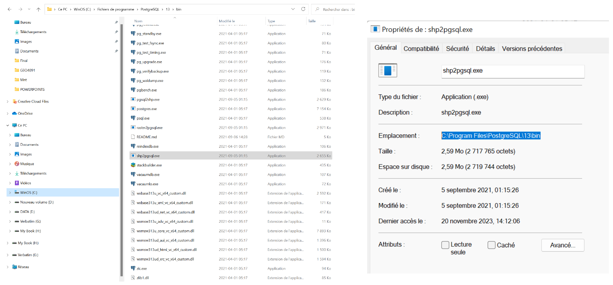
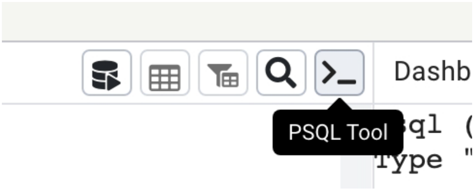
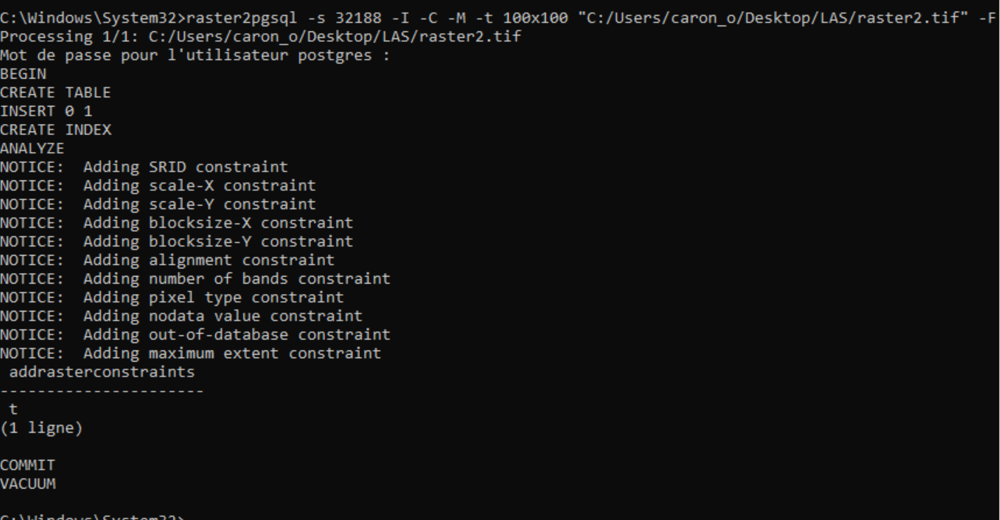
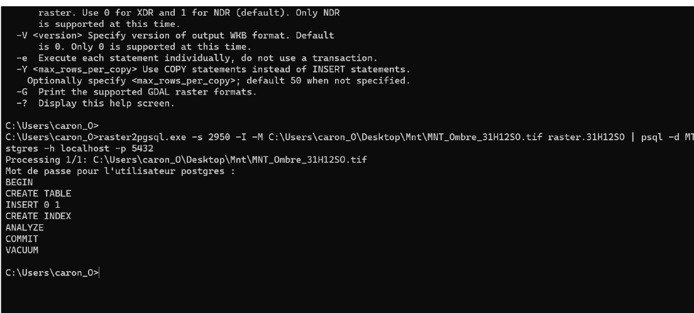
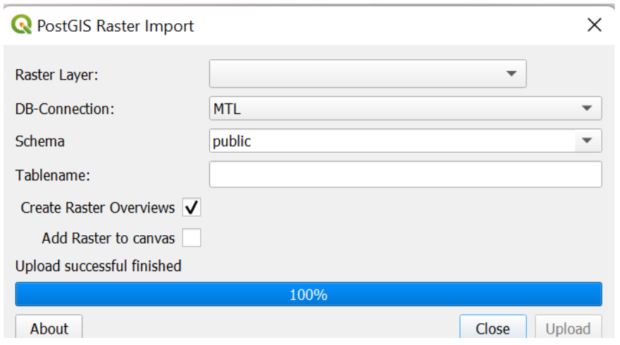
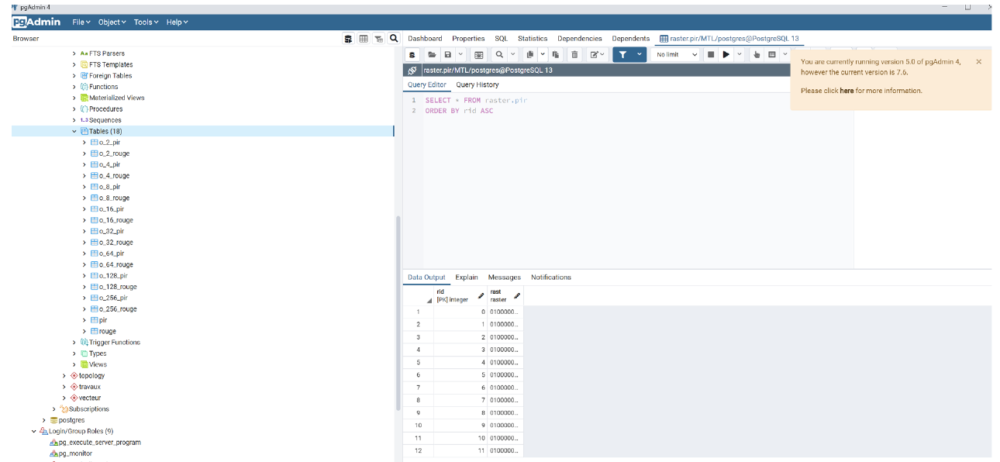
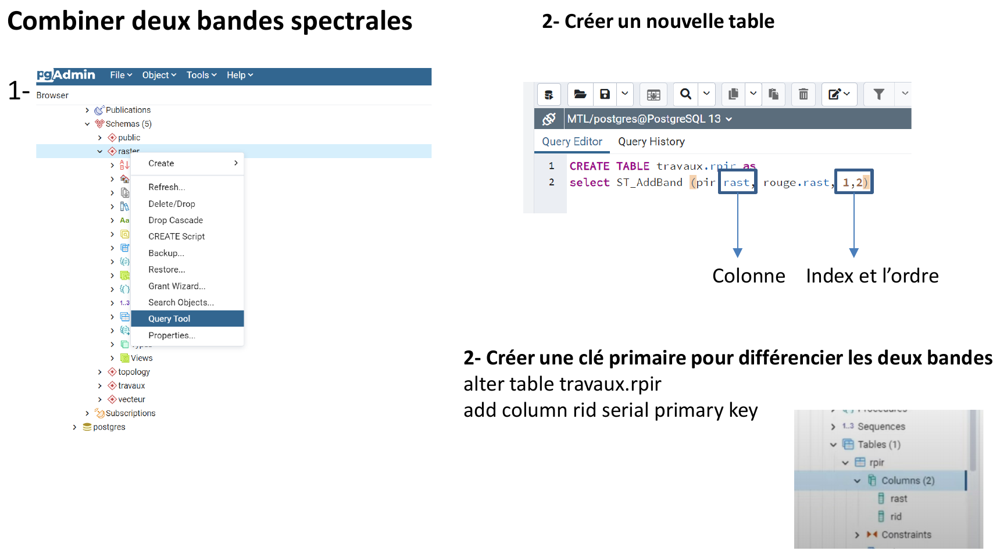
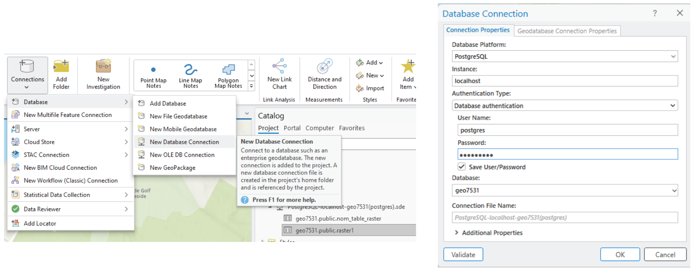
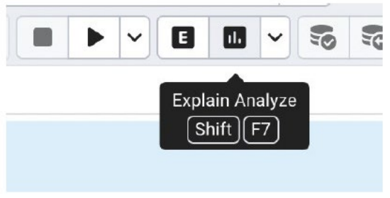
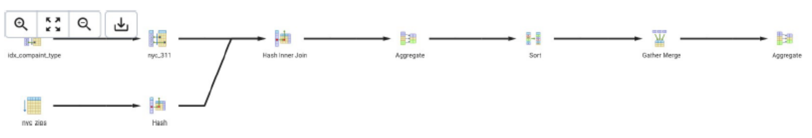

# GEO7531 — Importer des données vectorielles, matricielles et LiDAR dans PostGIS

Tutoriel détaillé qui accompagne la présentation *Importation des données matricielles et LiDAR* du cours GEO7531.
Il reprend le contenu de la présentation, **corrige plusieurs erreurs** qui s'y trouvaient (signalées par 🔧) et ajoute des sections pratiques : `COPY`, `ogr2ogr`, traitements raster, LiDAR et dépannage.

> **Pour qui ?** Étudiant·e·s qui savent créer une base dans pgAdmin et qui veulent importer des jeux de données trop gros pour QGIS, ou automatiser leurs importations.

---

## Table des matières

0. [Avant de commencer : où taper quelle commande ?](#0-avant-de-commencer--où-taper-quelle-commande-)
1. [Préparer la base de données](#1-préparer-la-base-de-données)
2. [Rendre les outils accessibles (variable PATH)](#2-rendre-les-outils-accessibles-variable-path)
3. [Le terminal psql](#3-le-terminal-psql)
4. [Importer un CSV avec COPY / \copy](#4-importer-un-csv-avec-copy--copy)
5. [Importer un shapefile avec shp2pgsql](#5-importer-un-shapefile-avec-shp2pgsql)
6. [Importer GeoJSON, KML, GeoPackage… avec ogr2ogr](#6-importer-geojson-kml-geopackage-avec-ogr2ogr)
7. [Importer des données matricielles avec raster2pgsql](#7-importer-des-données-matricielles-avec-raster2pgsql)
8. [Traiter les rasters dans PostGIS (bandes, NDVI, statistiques)](#8-traiter-les-rasters-dans-postgis)
9. [Données LiDAR](#9-données-lidar)
10. [Visualiser dans QGIS et ArcGIS Pro](#10-visualiser-dans-qgis-et-arcgis-pro)
11. [Optimiser les requêtes avec EXPLAIN ANALYZE](#11-optimiser-les-requêtes-avec-explain-analyze)
12. [Récapitulatif des corrections apportées à la présentation](#12-récapitulatif-des-corrections-apportées-à-la-présentation)
13. [Dépannage](#13-dépannage)
14. [Références](#14-références)

Fichiers utiles dans ce dossier :

| Dossier | Contenu |
|---|---|
| [`scripts/`](scripts/) | Scripts SQL et `.bat` prêts à adapter, un par étape |
| [`donnees_exemple/`](donnees_exemple/) | Petit CSV pour pratiquer l'importation (section 4) |
| [`images/`](images/) | Captures d'écran |

---

## 0. Avant de commencer : où taper quelle commande ?

C'est **la principale source de confusion**. Trois « terminaux » différents servent dans ce tutoriel, et une commande tapée au mauvais endroit ne fonctionne pas.

| Où ? | Comment l'ouvrir | On y tape… | Exemple |
|---|---|---|---|
| **Invite de commandes Windows** (`cmd`) | Menu Démarrer → taper `cmd` | Les **programmes** : `shp2pgsql`, `raster2pgsql`, `psql`, `pg_dump`… | `shp2pgsql -s 32188 -I ...` |
| **psql** (terminal PostgreSQL) | pgAdmin → bouton **PSQL Tool**, ou `psql` dans `cmd` | Du **SQL** et les **méta-commandes** `\dt`, `\copy`… | `\dt vecteur.*` |
| **Query Tool** de pgAdmin | Clic droit sur la base → **Query Tool** | Du **SQL** seulement | `SELECT * FROM ...;` |
| **OSGeo4W Shell** (installé avec QGIS) | Menu Démarrer → *OSGeo4W Shell* | `ogr2ogr`, `gdalinfo`, `pdal` | `ogr2ogr -f PostgreSQL ...` |

> 🔧 **Correction :** dans la présentation, le bouton *PSQL Tool* de pgAdmin est présenté juste avant les commandes `shp2pgsql` et `raster2pgsql`. Or **ces deux outils ne s'exécutent pas dans psql** : ce sont des programmes à lancer dans l'invite de commandes Windows. Ils produisent du SQL qu'on envoie ensuite à psql avec le symbole `|` (*pipe*).

### Conventions utilisées

- Base de données : `geo7531`, **en minuscules** (voir l'encadré ci-dessous).
- Utilisateur : `postgres` ; serveur : `localhost`, port `5432`.
- Système de coordonnées des exemples : **EPSG:32188** (NAD83 / MTM zone 8, Montréal).
- Schémas : `vecteur`, `raster`, `travaux` et `lidar`.

> ⚠️ **Majuscules dans les noms de bases.** Une base créée dans pgAdmin sous le nom `GEO7531` est différente de `geo7531`. En SQL, `CREATE DATABASE GEO7531;` crée en réalité `geo7531`, car PostgreSQL convertit en minuscules les noms sans guillemets. Une commande comme `psql -d geo7531` échouera donc sur une base créée sous le nom `GEO7531` (message `database "geo7531" does not exist`).
> **Conseil :** nommez toujours vos bases, schémas, tables et colonnes **en minuscules, sans accents ni espaces**. Si votre base s'appelle déjà `GEO7531`, écrivez exactement `-d GEO7531` dans les commandes, en respectant la casse.

---

## 1. Préparer la base de données

### 1.1 Créer la base

Dans pgAdmin : clic droit sur **Databases → Create → Database...**, nom `geo7531`, puis **Save**.

Ou dans psql :

```sql
CREATE DATABASE geo7531;
\c geo7531
```

`\c` (pour *connect*) est une méta-commande psql qui vous connecte à la nouvelle base. Elle ne fonctionne pas dans le Query Tool.

### 1.2 Activer les extensions

Ouvrez le Query Tool **sur la base `geo7531`** et exécutez :

```sql
CREATE EXTENSION IF NOT EXISTS postgis;          -- géométries (vectoriel)
CREATE EXTENSION IF NOT EXISTS postgis_raster;   -- rasters (PostGIS 3 et plus)

-- Facultatif, pour stocker des nuages de points LiDAR (section 9)
CREATE EXTENSION IF NOT EXISTS pointcloud;
CREATE EXTENSION IF NOT EXISTS pointcloud_postgis;
```

Depuis PostGIS 3, le support raster est une extension séparée (`postgis_raster`) : sans elle, `raster2pgsql` échoue avec `type "raster" does not exist`.

Vérification :

```sql
SELECT postgis_full_version();
```

Le résultat doit mentionner `RASTER`. Dans psql, `\dx` liste les extensions installées.

### 1.3 Créer des schémas pour organiser les données

La présentation propose trois schémas. Voici le SQL correspondant, avec un quatrième pour le LiDAR :

```sql
CREATE SCHEMA IF NOT EXISTS vecteur;   -- données vectorielles importées
CREATE SCHEMA IF NOT EXISTS raster;    -- données matricielles importées
CREATE SCHEMA IF NOT EXISTS travaux;   -- résultats de traitements
CREATE SCHEMA IF NOT EXISTS lidar;     -- nuages de points
```

Pourquoi des schémas ? On sépare ainsi les données brutes, qu'on ne modifie pas, des résultats de travail, qu'on peut supprimer et recréer. On peut aussi sauvegarder ou donner des droits schéma par schéma.

📄 Script complet : [`scripts/01_preparer_base.sql`](scripts/01_preparer_base.sql)

---

## 2. Rendre les outils accessibles (variable PATH)

`psql`, `shp2pgsql`, `raster2pgsql` et `pg_dump` se trouvent dans le dossier `bin` de PostgreSQL :

```
C:\Program Files\PostgreSQL\16\bin
```

> 🔧 **Mise à jour :** la présentation montre `PostgreSQL\13\bin`. Adaptez le numéro à **votre** version (16 dans le cours).
> `shp2pgsql.exe` et `raster2pgsql.exe` ne sont présents dans ce dossier que si **PostGIS** a été installé, par exemple avec *Stack Builder → Spatial Extensions → PostGIS Bundle*.



### Option A — Ajouter le dossier au PATH (recommandé, une seule fois)

1. Menu Démarrer → tapez **« variables d'environnement »** → *Modifier les variables d'environnement système*.
2. Bouton **Variables d'environnement...**
3. Dans *Variables utilisateur*, sélectionnez **Path** → **Modifier...** → **Nouveau**.
4. Collez `C:\Program Files\PostgreSQL\16\bin` → **OK** trois fois.
5. **Fermez et rouvrez** l'invite de commandes, puis vérifiez :

```bat
psql --version
shp2pgsql
raster2pgsql -G
```

`shp2pgsql` sans argument affiche son aide. `raster2pgsql -G` affiche la liste des formats raster pris en charge.

### Option B — Appeler l'outil par son chemin complet

Sans modifier le PATH, mettez le chemin entre guillemets, car il contient un espace :

```bat
"C:\Program Files\PostgreSQL\16\bin\shp2pgsql.exe" -?
```

### Éviter de retaper le mot de passe

Chaque `psql` demande le mot de passe. Pour la durée de la session `cmd` uniquement :

```bat
set PGPASSWORD=votre_mot_de_passe
```

Solution permanente et plus sûre : créez le fichier `%APPDATA%\postgresql\pgpass.conf` contenant une ligne :

```
localhost:5432:*:postgres:votre_mot_de_passe
```

### Éviter les accents corrompus (Windows)

L'invite de commandes Windows n'utilise pas UTF-8 par défaut. Les accents peuvent alors devenir `é` après l'importation. Avant d'importer, tapez dans `cmd` :

```bat
set PGCLIENTENCODING=UTF8
```

---

## 3. Le terminal psql

psql est l'interface en ligne de commande de PostgreSQL. On y exécute du SQL, on administre les bases et on interroge les données spatiales.

### 3.1 Ouvrir psql

**Depuis pgAdmin :** sélectionnez la base dans l'Object Explorer, puis cliquez sur le bouton **PSQL Tool**. psql s'ouvre déjà connecté à cette base.



**Depuis l'invite de commandes :**

```bat
psql -h localhost -p 5432 -U postgres -d geo7531
```

| Option | Signification |
|---|---|
| `-h` | Serveur (*host*) |
| `-p` | Port (5432 par défaut) |
| `-U` | Utilisateur |
| `-d` | Base de données |
| `-f fichier.sql` | Exécute un fichier SQL puis quitte |
| `-c "requête"` | Exécute une seule commande puis quitte |

### 3.2 Méta-commandes utiles

Elles commencent par `\` et ne se terminent **pas** par `;`.

| Commande | Effet |
|---|---|
| `\l` | Liste les bases de données |
| `\c geo7531` | Se connecte à une autre base |
| `\dn` | Liste les schémas |
| `\dt` | Liste les tables du schéma `public` |
| `\dt vecteur.*` | Liste les tables d'un schéma précis |
| `\d vecteur.stations` | Structure d'une table (colonnes, index) |
| `\dx` | Extensions installées |
| `\i C:/chemin/script.sql` | Exécute un fichier SQL (utilisez des `/`) |
| `\copy ...` | Importe ou exporte un CSV depuis votre ordinateur (section 4) |
| `\timing` | Affiche la durée de chaque requête |
| `\x` | Affichage vertical, pratique pour les lignes très larges |
| `\?` | Aide des méta-commandes |
| `\q` | Quitte psql |

> 💡 Si `\dt` n'affiche pas vos tables, c'est souvent qu'elles sont dans un autre schéma que `public`. Utilisez `\dt *.*` ou `\dt vecteur.*`.

### 3.3 Requêtes SQL et spatiales

N'oubliez pas le `;` à la fin des requêtes SQL. Sans lui, psql attend la suite : l'invite passe de `geo7531=#` à `geo7531-#`.

```sql
SELECT * FROM vecteur.stations LIMIT 10;
```

Exemple de requête spatiale : objets situés à moins de 1000 m d'un point.

> 🔧 **Correction de l'exemple de la présentation :**
> ```sql
> -- Version de la présentation (problématique)
> SELECT * FROM ma_table
> WHERE ST_DWithin(geom, ST_MakePoint(1.23, 4.56)::geography, 1000);
> ```
> Trois problèmes :
> 1. `ST_MakePoint` crée un point **sans système de coordonnées** (SRID 0). Il faut l'indiquer avec `ST_SetSRID(..., 4326)`.
> 2. L'ordre des coordonnées est **(longitude, latitude)**, c'est-à-dire (x, y), et non l'inverse.
> 3. Le type `geography` n'accepte que des coordonnées en degrés (EPSG:4326). Si `geom` est en MTM 8 (32188), la requête échoue. Si `geom` est en 4326, elle fonctionne, mais la conversion empêche l'utilisation de l'index spatial, ce qui la rend lente sur de gros jeux de données.

Versions correctes selon le système de coordonnées de la table :

```sql
-- Table en MTM 8 (EPSG:32188), unités en mètres : on reprojette le point vers 32188.
-- C'est la version la plus rapide, car elle utilise l'index spatial.
SELECT *
FROM vecteur.stations
WHERE ST_DWithin(
        geom,
        ST_Transform(ST_SetSRID(ST_MakePoint(-73.5617, 45.5152), 4326), 32188),
        1000);   -- 1000 mètres

-- Table en WGS84 (EPSG:4326), unités en degrés : on passe par geography pour travailler en mètres.
SELECT *
FROM vecteur.stations_wgs84
WHERE ST_DWithin(
        geom::geography,
        ST_SetSRID(ST_MakePoint(-73.5617, 45.5152), 4326)::geography,
        1000);   -- 1000 mètres
```

> 💡 Pour connaître le SRID d'une table : `SELECT Find_SRID('vecteur', 'stations', 'geom');`
> Pour toutes les couches : `SELECT * FROM geometry_columns;`

---

## 4. Importer un CSV avec COPY / \copy

`COPY` est la méthode la plus rapide pour charger de gros fichiers tabulaires : des millions de lignes en quelques secondes.

> 🔧 **Corrections :**
> - La présentation affirme que COPY « ne fonctionne qu'avec des fichiers CSV ». En réalité, COPY lit trois formats : `text` (séparé par des tabulations, le format par défaut), `csv` et `binary`. En pratique, on l'utilise surtout avec des CSV et des fichiers texte délimités.
> - **`COPY ... FROM 'C:/...'` est lu par le serveur PostgreSQL, pas par votre ordinateur.** Il faut être superutilisateur, et le service PostgreSQL doit avoir le droit de lire le fichier. Sinon : `permission denied` ou `could not open file`. Dans psql, utilisez plutôt **`\copy`**, qui lit le fichier sur votre ordinateur avec vos propres droits. C'est d'ailleurs ce que suggère le message d'erreur de PostgreSQL.

### 4.1 Étapes

Le fichier d'exemple [`donnees_exemple/stations_exemple.csv`](donnees_exemple/stations_exemple.csv) est séparé par des **points-virgules** et encodé en **UTF-8** :

```
id;nom;longitude;latitude;achalandage
1;Berri-UQAM;-73.5617;45.5152;12500
...
```

**1) Créer la table.** COPY ne crée pas la table : ses colonnes doivent correspondre à celles du fichier, dans le même ordre.

```sql
CREATE TABLE vecteur.stations (
    id          integer PRIMARY KEY,
    nom         text,
    longitude   double precision,
    latitude    double precision,
    achalandage integer
);
```

**2) Importer avec `\copy`**, dans psql, sur une seule ligne :

```
\copy vecteur.stations FROM 'C:/GEO7531/donnees_exemple/stations_exemple.csv' WITH (FORMAT csv, HEADER true, DELIMITER ';', ENCODING 'UTF8')
```

| Option | Rôle |
|---|---|
| `FORMAT csv` | Fichier CSV (gère les guillemets autour des textes) |
| `HEADER true` | La 1re ligne contient les noms de colonnes : elle est ignorée |
| `DELIMITER ';'` | Séparateur ; `','` par défaut en CSV |
| `ENCODING 'UTF8'` | Encodage du fichier (`'LATIN1'` pour un vieux fichier Excel) |
| `NULL ''` | Valeur à interpréter comme vide |

psql répond `COPY 5` (le nombre de lignes importées).

> 💡 Utilisez des barres obliques `/` dans les chemins, même sous Windows. Évitez les espaces et les accents dans le chemin.

**3) Créer la géométrie** à partir des colonnes longitude et latitude :

```sql
ALTER TABLE vecteur.stations ADD COLUMN geom geometry(Point, 32188);

UPDATE vecteur.stations
SET geom = ST_Transform(
             ST_SetSRID(ST_MakePoint(longitude, latitude), 4326),  -- point en WGS84
             32188);                                               -- reprojeté en MTM 8

CREATE INDEX stations_geom_idx ON vecteur.stations USING gist (geom);
ANALYZE vecteur.stations;
```

**4) Vérifier :**

```sql
SELECT id, nom, ST_AsText(geom) FROM vecteur.stations;
```

### 4.2 Exporter une requête vers un CSV

```
\copy (SELECT nom, achalandage FROM vecteur.stations ORDER BY achalandage DESC) TO 'C:/GEO7531/export_stations.csv' WITH (FORMAT csv, HEADER true)
```

### 4.3 Importer un CSV dans pgAdmin, sans psql

Clic droit sur la table → **Import/Export Data...** → onglet *Import*, choisir le fichier, cocher *Header*, et choisir le délimiteur. pgAdmin exécute un `\copy` pour vous.

📄 Script complet : [`scripts/02_import_csv.sql`](scripts/02_import_csv.sql)

---

## 5. Importer un shapefile avec shp2pgsql

`shp2pgsql` convertit un shapefile (`.shp`, `.shx`, `.dbf`, `.prj`) en instructions SQL. On envoie ce SQL à psql.

### 5.1 Syntaxe générale

```bat
shp2pgsql [options] chemin\fichier.shp schema.table | psql -h localhost -U postgres -d geo7531
```

Le `|` (*pipe*) envoie directement la sortie de `shp2pgsql` à `psql`. Les deux programmes s'exécutent dans l'**invite de commandes**.

**Variante en deux temps**, recommandée pour comprendre ou déboguer :

```bat
shp2pgsql -s 32188 -I C:\GEO7531\donnees\arrondissements.shp vecteur.arrondissements > arrondissements.sql
psql -h localhost -U postgres -d geo7531 -f arrondissements.sql
```

On peut ouvrir `arrondissements.sql` dans un éditeur de texte pour voir le `CREATE TABLE` et les `INSERT` générés.

### 5.2 Options de shp2pgsql (version corrigée)

> 🔧 **Correction importante :** la liste d'options de la présentation contient **plusieurs erreurs**, résumées ci-dessous. Le tableau qui suit donne la signification exacte selon la documentation officielle de PostGIS. En cas de doute, tapez `shp2pgsql` sans argument pour afficher l'aide de **votre** version.

| Option | Ce qu'elle fait réellement | Ce qu'en disait la présentation |
|---|---|---|
| `-s SRID` | Indique le système de coordonnées des données, par exemple `-s 32188`. **N'opère aucune reprojection.** | ✅ Correct |
| `-s DE:VERS` | **Reprojette** à l'importation, par exemple `-s 2950:32188` | *(absent)* |
| `-I` | Crée un index spatial GiST sur la géométrie | ✅ Correct |
| `-W encodage` | Encodage des attributs du `.dbf` (`UTF-8`, `LATIN1`…) | ✅ Correct |
| `-g nom` | Nom de la colonne géométrique (`geom` par défaut) | ✅ Correct |
| `-k` | Conserve la casse des noms de colonnes | ✅ Correct |
| `-c` | Crée la table et insère les données (mode par défaut) | ✅ Correct |
| `-a` | Ajoute les données à une table existante | ✅ Correct |
| `-d` | Supprime la table existante puis la recrée | ✅ Correct |
| `-p` | Génère seulement la structure (`CREATE TABLE`), sans données | ✅ Correct |
| `-D` | Utilise le format **dump** de PostgreSQL (`COPY`) au lieu d'`INSERT` : **beaucoup plus rapide** pour les gros fichiers | ❌ « suppression des doublons, divise les multi-parties » |
| `-G` | Utilise le type **geography** au lieu de geometry (uniquement en 4326) | ❌ « métadonnées géographiques, emprise » |
| `-S` | Produit des géométries **simples** (POLYGON) au lieu de MULTI ; échoue si une entité est réellement multi-parties | ❌ « supprime les géométries SRID » |
| `-m fichier` | Fichier de correspondance entre noms de colonnes longs et noms DBF à 10 caractères | ❌ « mode multi-géométries ». Par défaut, shp2pgsql produit **déjà** des MULTI |
| `-n` | Importe **uniquement le `.dbf`**, sans géométrie | ❌ « spécifie le schéma ». Le schéma se donne dans le nom de table : `vecteur.ma_table` |
| `-i` | Force les entiers en `integer` (32 bits) | *(absent)* |
| `-N politique` | Que faire des géométries nulles : `insert`, `skip` ou `abort` | *(absent)* |
| `-e` | Exécute chaque instruction séparément, sans transaction (incompatible avec `-D`) | *(absent)* |
| `-w` | Écrit les géométries en WKT au lieu de WKB (perte de précision possible) | *(absent)* |
| `-T` / `-X` | Tablespace de la table / des index | *(absent)* |
| `-C` | **N'existe pas** dans shp2pgsql | ❌ « contraintes de validité » |
| `-t 100x100` | **Le tuilage n'existe pas pour les vecteurs.** C'est une option de `raster2pgsql`. | ❌ « divise les grandes géométries en tuiles » |

> 🔧 **La « commande complète » de la présentation ne fonctionne pas :**
> ```
> shp2pgsql -s 4326 -I -W UTF8 -g ma_geom -n public -t 100x100 "C:/chemin/vers/fichier.shp" schema.nom_table | psql ...
> ```
> - `-n` importerait **seulement la table attributaire, sans géométrie**, et `public` serait pris pour le nom du fichier.
> - `-t 100x100` n'est pas une option de tuilage de shp2pgsql.
> - `-s 4326` ne convient que si le shapefile est réellement en WGS84.

### 5.3 Exemples corrects

**Importation simple** (shapefile déjà en MTM 8) :

```bat
set PGCLIENTENCODING=UTF8
shp2pgsql -s 32188 -I -W UTF-8 C:\GEO7531\donnees\arrondissements.shp vecteur.arrondissements | psql -h localhost -U postgres -d geo7531
```

Réponse attendue de psql : `SET`, `BEGIN`, `CREATE TABLE`, plusieurs `INSERT 0 1`, `CREATE INDEX`, puis `COMMIT`.

**Gros fichier** (des centaines de milliers d'entités) avec le format rapide `-D` :

```bat
shp2pgsql -s 32188 -D -I C:\GEO7531\donnees\batiments.shp vecteur.batiments | psql -h localhost -U postgres -d geo7531
```

**Reprojeter pendant l'importation**, ici de NAD83(CSRS) MTM 8 vers NAD83 MTM 8 (sans `-D`, incompatible avec la reprojection) :

```bat
shp2pgsql -s 2950:32188 -I C:\GEO7531\donnees\routes.shp vecteur.routes | psql -h localhost -U postgres -d geo7531
```

**Fusionner plusieurs shapefiles de même structure dans une seule table**, par exemple un fichier par feuillet :

```bat
shp2pgsql -p -s 32188 C:\GEO7531\donnees\feuillet_01.shp vecteur.hydro | psql -U postgres -d geo7531
shp2pgsql -a -s 32188 C:\GEO7531\donnees\feuillet_01.shp vecteur.hydro | psql -U postgres -d geo7531
shp2pgsql -a -s 32188 C:\GEO7531\donnees\feuillet_02.shp vecteur.hydro | psql -U postgres -d geo7531
psql -U postgres -d geo7531 -c "CREATE INDEX ON vecteur.hydro USING gist (geom);"
```

**Réimporter en remplaçant la table :** remplacez `-c` (par défaut) par `-d`.

### 5.4 Quel SRID choisir ?

`-s` doit correspondre au système **réel** du shapefile, décrit dans le fichier `.prj`. Pour le connaître : ouvrez la couche dans QGIS → *Propriétés → Information*, ou ouvrez le `.prj` dans un éditeur de texte.

| Code EPSG | Système | Usage courant au Québec |
|---|---|---|
| 4326 | WGS84, degrés | GPS, données web, GeoJSON |
| 32188 | NAD83 / MTM zone 8 | Montréal (données municipales) |
| 2950 | NAD83(CSRS) / MTM zone 8 | Données gouvernementales récentes (MTM 8) |
| 32198 | NAD83 / Québec Lambert | Cartes à l'échelle du Québec |
| 6622 | NAD83(CSRS) / Québec Lambert | Idem, référence CSRS |

> ⚠️ `-s 32188` **étiquette** les données comme étant en MTM 8, mais ne les transforme pas. Un mauvais code donne des données « au mauvais endroit », par exemple au milieu de l'océan. Pour corriger après coup :
> ```sql
> -- Le SRID était faux (les coordonnées sont bonnes) : on change l'étiquette
> SELECT UpdateGeometrySRID('vecteur', 'routes', 'geom', 2950);
> -- On veut réellement reprojeter vers un autre système
> ALTER TABLE vecteur.routes
>   ALTER COLUMN geom TYPE geometry(MultiLineString, 32188)
>   USING ST_Transform(geom, 32188);
> ```

### 5.5 Vérifier l'importation

```sql
-- La table est-elle enregistrée avec le bon type et le bon SRID ?
SELECT f_table_schema, f_table_name, type, srid
FROM geometry_columns
WHERE f_table_schema = 'vecteur';

-- Nombre d'entités (à comparer avec la table attributaire dans QGIS)
SELECT count(*) FROM vecteur.arrondissements;

-- Géométries invalides ?
SELECT gid, ST_IsValidReason(geom)
FROM vecteur.arrondissements
WHERE NOT ST_IsValid(geom);

-- Les réparer si nécessaire
UPDATE vecteur.arrondissements
SET geom = ST_Multi(ST_CollectionExtract(ST_MakeValid(geom), 3))
WHERE NOT ST_IsValid(geom);
```

Le `3` de `ST_CollectionExtract` conserve les polygones. Utilisez `2` pour des lignes et `1` pour des points.

> 💡 **Interface graphique :** l'installation de PostGIS sous Windows inclut souvent le *PostGIS Shapefile Import/Export Manager* (`shp2pgsql-gui`). Il fait la même chose avec des cases à cocher.

📄 Modèle : [`scripts/03_import_shp.bat`](scripts/03_import_shp.bat)

---

## 6. Importer GeoJSON, KML, GeoPackage… avec ogr2ogr

La présentation désigne `ogr2ogr` comme l'une des deux méthodes préférées, mais n'en montre aucun exemple. Le voici.

`ogr2ogr` fait partie de **GDAL**. Il lit plus de 80 formats vectoriels, peut **reprojeter**, **filtrer** et **transformer avec du SQL** pendant l'importation.

### 6.1 Où trouver ogr2ogr ?

Si QGIS est installé : menu Démarrer → **OSGeo4W Shell**. Vérifiez avec :

```bat
ogr2ogr --version
```

### 6.2 La chaîne de connexion PostgreSQL

ogr2ogr se connecte à la base avec une chaîne `PG:"..."` :

```bat
PG:"host=localhost port=5432 dbname=geo7531 user=postgres password=votre_mot_de_passe"
```

ogr2ogr ne demande pas le mot de passe de façon interactive. Mettez-le dans la chaîne, ou faites `set PGPASSWORD=...` avant.

### 6.3 Exemples

**GeoJSON → PostGIS, avec reprojection vers MTM 8 :**

```bat
ogr2ogr -f PostgreSQL PG:"host=localhost dbname=geo7531 user=postgres" ^
  C:\GEO7531\donnees\quartiers.geojson ^
  -nln vecteur.quartiers ^
  -t_srs EPSG:32188 ^
  -nlt PROMOTE_TO_MULTI ^
  -lco GEOMETRY_NAME=geom ^
  -lco FID=gid ^
  -progress
```

Le `^` permet de couper une longue commande sur plusieurs lignes dans `cmd`.

| Option | Rôle |
|---|---|
| `-f PostgreSQL` | Format de sortie |
| `-nln vecteur.quartiers` | Nom (et schéma) de la nouvelle table |
| `-t_srs EPSG:32188` | Reprojette vers ce système |
| `-s_srs EPSG:xxxx` | Système de la source, si le fichier ne le précise pas |
| `-nlt PROMOTE_TO_MULTI` | Convertit tout en MULTI, ce qui évite les erreurs quand un fichier mélange POLYGON et MULTIPOLYGON |
| `-lco GEOMETRY_NAME=geom` | Nom de la colonne géométrique (`wkb_geometry` par défaut) |
| `-lco FID=gid` | Nom de la clé primaire |
| `-overwrite` / `-append` | Remplace la table / ajoute à la table |
| `-where "condition"` | Importe seulement certaines entités |
| `-sql "SELECT ..."` | Transforme les données avec du SQL avant l'importation |
| `-dim XY` | Supprime la coordonnée Z (utile pour le KML) |
| `-progress` | Barre de progression |

L'index spatial est créé automatiquement.

**KML** (souvent en 3D et parfois composé de plusieurs couches) :

```bat
ogrinfo C:\GEO7531\donnees\sentiers.kml
ogr2ogr -f PostgreSQL PG:"host=localhost dbname=geo7531 user=postgres" ^
  C:\GEO7531\donnees\sentiers.kml ^
  -nln vecteur.sentiers -t_srs EPSG:32188 -dim XY -nlt PROMOTE_TO_MULTI -lco GEOMETRY_NAME=geom
```

`ogrinfo` liste d'abord les couches contenues dans le fichier.

**GeoPackage** (précisez la couche à la fin) :

```bat
ogrinfo C:\GEO7531\donnees\donnees.gpkg
ogr2ogr -f PostgreSQL PG:"host=localhost dbname=geo7531 user=postgres" ^
  C:\GEO7531\donnees\donnees.gpkg parcs ^
  -nln vecteur.parcs -t_srs EPSG:32188 -lco GEOMETRY_NAME=geom
```

**Filtrer pendant l'importation** :

```bat
ogr2ogr -f PostgreSQL PG:"host=localhost dbname=geo7531 user=postgres" ^
  C:\GEO7531\donnees\batiments.shp ^
  -nln vecteur.grands_batiments -t_srs EPSG:32188 -lco GEOMETRY_NAME=geom ^
  -where "SUPERFICIE > 1000"
```

**CSV avec longitude et latitude** (alternative à la section 4, qui crée la géométrie directement) :

```bat
ogr2ogr -f PostgreSQL PG:"host=localhost dbname=geo7531 user=postgres" ^
  C:\GEO7531\donnees_exemple\stations_exemple.csv ^
  -oo X_POSSIBLE_NAMES=longitude -oo Y_POSSIBLE_NAMES=latitude -oo SEPARATOR=SEMICOLON ^
  -s_srs EPSG:4326 -t_srs EPSG:32188 ^
  -nln vecteur.stations_ogr -lco GEOMETRY_NAME=geom
```

**Exporter de PostGIS vers un GeoPackage** :

```bat
ogr2ogr -f GPKG C:\GEO7531\export.gpkg PG:"host=localhost dbname=geo7531 user=postgres" vecteur.quartiers
```

### 6.4 Quelle méthode choisir ?

| Situation | Outil conseillé |
|---|---|
| Petit fichier, une seule fois | QGIS (glisser-déposer dans *DB Manager* ou *Exporter vers PostgreSQL*) |
| Shapefile volumineux | `shp2pgsql -D` |
| GeoJSON, KML, GPKG, GML… ou reprojection et filtrage | `ogr2ogr` |
| Gros CSV tabulaire | `\copy`, puis création de la géométrie en SQL |
| Raster | `raster2pgsql` |

📄 Modèle : [`scripts/04_import_ogr2ogr.bat`](scripts/04_import_ogr2ogr.bat)

---

## 7. Importer des données matricielles avec raster2pgsql

PostGIS ne lit pas directement un fichier image. `raster2pgsql` le découpe en tuiles et génère le SQL pour les stocker dans une colonne de type `raster`.

### 7.1 Prérequis

1. Les extensions `postgis` **et** `postgis_raster` sont activées dans la base (section 1.2).
2. `raster2pgsql` est accessible depuis l'invite de commandes (section 2).
3. Le raster est dans un format lu par GDAL : GeoTIFF, ASCII Grid, Erdas `.img`, NetCDF, JPEG, PNG…

> 🔧 **Correction :** la présentation indique `raster2pgsql --formats` pour lister les formats. La bonne option est **`raster2pgsql -G`**.

### 7.2 Connaître le SRID du raster

Dans le OSGeo4W Shell :

```bat
gdalinfo C:\GEO7531\donnees\mnt.tif
```

Repérez la ligne `ID["EPSG",....]` à la fin du bloc *Coordinate System*. Vous pouvez aussi passer par QGIS → *Propriétés de la couche → Information*.

> 🔧 **Point important de la présentation, précisé :** utilisez le SRID réel du fichier, et non 4326 par défaut. Dans les captures de la présentation, un raster est importé avec `-s 32188` (NAD83 / MTM 8) et un autre (`MNT_Ombre_31H12SO`) avec `-s 2950` (NAD83(CSRS) / MTM 8). Ces deux systèmes sont proches mais différents. Pour superposer ou croiser ces couches dans PostGIS, elles doivent avoir le **même SRID**, sinon `ST_Intersects`, `ST_Clip` et les autres fonctions renvoient une erreur.

### 7.3 Syntaxe et options (version corrigée)

```bat
raster2pgsql [options] fichier.tif schema.table | psql -h localhost -U postgres -d geo7531
```

| Option | Signification exacte |
|---|---|
| `-s SRID` | Système de coordonnées du raster |
| `-I` | Crée un index spatial GiST sur l'emprise des tuiles |
| `-C` | Applique les **contraintes raster** standard (SRID, taille de pixel, nombre de bandes, type de pixel, NoData, alignement, étendue). La table apparaît ainsi correctement dans la vue `raster_columns`, et QGIS la lit plus facilement. |
| `-M` | Exécute `VACUUM ANALYZE` sur la table après le chargement (statistiques à jour, donc requêtes plus rapides) |
| `-t LxH` | Découpe le raster en **tuiles** de L × H pixels, par exemple `-t 100x100` |
| `-t auto` | Laisse l'outil calculer une taille de tuile adaptée |
| `-P` | Complète les tuiles de bord pour qu'elles aient toutes la même taille |
| `-F` | Ajoute une colonne **`filename`** avec le nom du fichier source (utile quand on charge plusieurs fichiers) |
| `-l 2,4,8` | Crée des **aperçus** (*overviews*) à ces facteurs de réduction, dans des tables `o_2_table`, `o_4_table`… |
| `-N valeur` | Valeur NoData pour les bandes qui n'en ont pas |
| `-b 1,3` | Importe seulement certaines bandes |
| `-Y` | Utilise `COPY` au lieu d'`INSERT` (plus rapide) |
| `-R` | Raster *out-db* : seules les métadonnées et le chemin du fichier sont stockés, pas les pixels |
| `-d` / `-a` / `-c` / `-p` | Supprimer et recréer / ajouter / créer (par défaut) / structure seulement, comme pour shp2pgsql |
| `-e` | Sans transaction globale |
| `-G` | Liste les formats pris en charge |

> 🔧 **Corrections de la diapositive « Explication de la syntaxe » :**
> - `-F` **n'est pas** « stocker les données dans une table au format raster ». Il ajoute une colonne avec le **nom du fichier** source.
> - `-M` **n'est pas** « ajuster la taille des tuiles ». Il lance `VACUUM ANALYZE` après l'importation. La taille des tuiles se règle avec `-t`.
> - `-C` ne garantit pas la « continuité des pixels ». Il applique les contraintes standard listées ci-dessus.
> - La diapositive explique `-s 4326` alors que la commande utilise `-s 32188`. C'est bien **32188** qui convient pour ce raster en MTM 8.

### 7.4 Commande type

```bat
set PGCLIENTENCODING=UTF8
raster2pgsql -s 32188 -I -C -M -t 100x100 -F "C:/GEO7531/donnees/mnt.tif" raster.mnt | psql -h localhost -U postgres -d geo7531
```

Pendant l'importation, psql affiche une série de messages. Elle se termine par `addrasterconstraints t`, puis `COMMIT` et `VACUUM` :



Les `NOTICE: Adding ... constraint` proviennent de l'option `-C`, et le `VACUUM` final de `-M`.

Autre exemple tiré de la présentation : un MNT importé avec `-s 2950`, sans `-C` ni tuilage. On y voit l'aide de raster2pgsql au-dessus de la commande.



**Charger plusieurs tuiles d'un coup** (mosaïque de fichiers) :

```bat
raster2pgsql -s 32188 -I -C -M -F -t 256x256 C:/GEO7531/donnees/ortho/*.tif raster.ortho | psql -h localhost -U postgres -d geo7531
```

**Avec aperçus**, pour un affichage rapide dans QGIS à petite échelle :

```bat
raster2pgsql -s 32188 -I -C -M -t 256x256 -l 2,4,8 C:/GEO7531/donnees/mnt.tif raster.mnt | psql -h localhost -U postgres -d geo7531
```

### 7.5 Le tuilage : pourquoi et quelle taille ?

Un raster est une grille de pixels. Stocké d'un seul bloc dans une ligne de la table, il devrait être lu en entier pour chaque requête, même si on n'interroge qu'une petite zone. Avec `-t`, chaque tuile devient **une ligne** de la table, avec sa propre emprise indexée.

- Un raster de 1000 × 1000 pixels découpé avec `-t 100x100` donne une grille de **10 × 10 = 100 tuiles**, donc 100 lignes.
- Une requête sur une petite zone ne lit que les tuiles concernées, grâce à l'index spatial créé par `-I`.
- La mémoire nécessaire à l'importation et aux traitements diminue.

Image utile : un grand tapis est lourd à soulever d'un coup. Coupé en carrés, chaque morceau se manipule facilement, et on peut recomposer le tout au besoin.

| Situation | Taille conseillée |
|---|---|
| Valeur par défaut raisonnable | `-t 100x100` à `-t 256x256`, ou `-t auto` |
| Erreurs de mémoire à l'importation | Tuiles plus petites (`-t 50x50`) |
| Petit raster, peu de requêtes locales | Tuiles plus grandes (`-t 500x500`) |
| Tuiles trop petites (par ex. `10x10`) | ⚠️ Des millions de lignes, une table et un index énormes, et des requêtes **plus lentes** |

> 💡 Si vous combinez ensuite plusieurs rasters, par exemple deux bandes (section 8), importez-les **avec la même taille de tuile** pour que les tuiles correspondent une à une.

### 7.6 Vérifier l'importation

```sql
-- Le raster est-il bien enregistré ? (les colonnes sont remplies grâce à -C)
SELECT r_table_schema, r_table_name, srid, scale_x, scale_y, num_bands, pixel_types, nodata_values
FROM raster_columns;

-- Nombre de tuiles
SELECT count(*) FROM raster.mnt;

-- SRID et métadonnées d'une tuile
SELECT rid, ST_SRID(rast), (ST_Metadata(rast)).*
FROM raster.mnt
LIMIT 1;

-- Métadonnées de la bande 1 (type de pixel, NoData…)
SELECT (ST_BandMetadata(rast, 1)).*
FROM raster.mnt
LIMIT 1;

-- Statistiques de la bande 1 sur l'ensemble des tuiles
SELECT (ST_SummaryStatsAgg(rast, 1, true)).*
FROM raster.mnt;
```

> 🔧 **Correction :** la présentation propose `SELECT srid FROM spatial_ref_sys WHERE srid = 32188;` comme « vérification post-importation ». Cette requête vérifie seulement que le code 32188 **existe dans le catalogue** de PostGIS, ce qui est toujours vrai. Elle ne dit rien du raster importé. Utilisez plutôt `raster_columns` ou `ST_SRID(rast)`, comme ci-dessus.

### 7.7 Alternative graphique : QGIS

QGIS peut aussi importer un raster vers PostGIS (outil *PostGIS Raster Import*, ou *Traitement → GDAL → Divers → Exporter le raster vers PostgreSQL*). C'est pratique pour un petit raster.



Avec *Create Raster Overviews* coché, QGIS crée les tables d'aperçus `o_2_...`, `o_4_...`, etc. C'est ce qu'on voit dans la liste des tables ci-dessous :



📄 Modèle : [`scripts/05_import_raster.bat`](scripts/05_import_raster.bat)

---

## 8. Traiter les rasters dans PostGIS

Exemple : on a importé la **bande rouge** et la **bande proche infrarouge (PIR)** d'une image satellite dans deux tables. Pour Landsat 8 et 9, ce sont les bandes 4 (rouge) et 5 (PIR) ; pour Sentinel-2, les bandes B4 et B8.

```bat
raster2pgsql -s 32188 -I -C -M -t 256x256 C:/GEO7531/donnees/B4.tif raster.rouge | psql -U postgres -d geo7531
raster2pgsql -s 32188 -I -C -M -t 256x256 C:/GEO7531/donnees/B5.tif raster.pir   | psql -U postgres -d geo7531
```

⚠️ Utilisez la **même taille de tuile** pour les deux bandes. Pour Landsat, le SRID d'origine est généralement une zone UTM : reprojetez d'abord avec QGIS ou `gdalwarp` si vous voulez du MTM 8.

### 8.1 Combiner deux bandes dans un raster multibande



> 🔧 **Correction de la requête de la présentation :**
> ```sql
> CREATE TABLE travaux.rpir AS
> SELECT ST_AddBand(pir.rast, rouge.rast, 1, 2)
> ```
> Il manque la clause `FROM` avec la **jointure** entre les tuiles des deux tables. Il manque aussi un alias pour la colonne résultat : sans `AS rast`, elle s'appelle `st_addband`. Enfin, l'ordre des arguments de `ST_AddBand(raster_destination, raster_source, bande_source, position)` place ici le PIR en bande 1 et le rouge en bande 2. Ce n'est pas faux, mais ce n'est pas l'ordre habituel (rouge, puis PIR).

Version complète :

```sql
CREATE TABLE travaux.rouge_pir AS
SELECT
    r.rid,
    ST_AddBand(r.rast, p.rast, 1) AS rast     -- bande 1 = rouge, bande 2 = PIR
FROM raster.rouge AS r
JOIN raster.pir   AS p
  ON  ST_UpperLeftX(r.rast) = ST_UpperLeftX(p.rast)   -- même tuile :
  AND ST_UpperLeftY(r.rast) = ST_UpperLeftY(p.rast);  -- même coin supérieur gauche

-- Clé primaire, index spatial et contraintes
ALTER TABLE travaux.rouge_pir ADD PRIMARY KEY (rid);
CREATE INDEX rouge_pir_rast_gist ON travaux.rouge_pir USING gist (ST_ConvexHull(rast));
SELECT AddRasterConstraints('travaux', 'rouge_pir', 'rast');

-- Vérification : 2 bandes
SELECT ST_NumBands(rast) FROM travaux.rouge_pir LIMIT 1;
```

La présentation ajoutait la clé primaire après coup avec `ALTER TABLE travaux.rpir ADD COLUMN rid serial PRIMARY KEY;`. Ici, on conserve directement le `rid` d'origine.

### 8.2 Calculer un NDVI

NDVI = (PIR − Rouge) / (PIR + Rouge). Les valeurs vont de −1 à 1 : plus elles sont élevées, plus la végétation est dense.

```sql
CREATE TABLE travaux.ndvi AS
SELECT
    rid,
    ST_MapAlgebra(
        rast, 1,          -- [rast1] = bande 1 = rouge
        rast, 2,          -- [rast2] = bande 2 = PIR
        'CASE WHEN [rast2.val] + [rast1.val] = 0 THEN NULL
              ELSE ([rast2.val]::float - [rast1.val]) / ([rast2.val]::float + [rast1.val])
         END',
        '32BF'            -- résultat en nombres réels (32 bits)
    ) AS rast
FROM travaux.rouge_pir;

ALTER TABLE travaux.ndvi ADD PRIMARY KEY (rid);
CREATE INDEX ndvi_rast_gist ON travaux.ndvi USING gist (ST_ConvexHull(rast));
SELECT AddRasterConstraints('travaux', 'ndvi', 'rast');
```

Deux précautions dans cette formule :
- `::float` évite une **division entière**. Les bandes satellites sont souvent en entiers, et 300 / 1000 donnerait 0 au lieu de 0,3.
- `CASE WHEN ... = 0` évite une division par zéro.

On peut aussi calculer le NDVI directement à partir des deux tables, sans l'étape `ST_AddBand` :

```sql
SELECT r.rid,
       ST_MapAlgebra(r.rast, 1, p.rast, 1,
         'CASE WHEN [rast2.val] + [rast1.val] = 0 THEN NULL
               ELSE ([rast2.val]::float - [rast1.val]) / ([rast2.val]::float + [rast1.val]) END',
         '32BF') AS rast
FROM raster.rouge r
JOIN raster.pir p
  ON ST_UpperLeftX(r.rast) = ST_UpperLeftX(p.rast)
 AND ST_UpperLeftY(r.rast) = ST_UpperLeftY(p.rast);
```

### 8.3 Croiser raster et vecteur

Les deux couches doivent avoir le **même SRID**.

**Valeur du raster sous chaque point** (altitude de chaque station, par exemple) :

```sql
SELECT s.nom, ST_Value(m.rast, 1, s.geom) AS altitude
FROM vecteur.stations s
JOIN raster.mnt m ON ST_Intersects(m.rast, s.geom);
```

**Statistiques zonales** (altitude moyenne, minimale et maximale par arrondissement) :

```sql
SELECT nom, (stats).count, (stats).mean, (stats).min, (stats).max
FROM (
    SELECT a.nom,
           ST_SummaryStatsAgg(ST_Clip(m.rast, a.geom), 1, true) AS stats
    FROM vecteur.arrondissements a
    JOIN raster.mnt m ON ST_Intersects(m.rast, a.geom)
    GROUP BY a.nom
) AS t
ORDER BY nom;
```

**Découper un raster selon un polygone** et enregistrer le résultat :

```sql
CREATE TABLE travaux.mnt_plateau AS
SELECT m.rid, ST_Clip(m.rast, a.geom, true) AS rast
FROM raster.mnt m
JOIN vecteur.arrondissements a
  ON ST_Intersects(m.rast, a.geom)
WHERE a.nom = 'Le Plateau-Mont-Royal';
```

**Vectoriser un raster** (polygones de pixels de même valeur, à réserver aux petits rasters ou aux rasters classifiés) :

```sql
SELECT (ST_DumpAsPolygons(rast, 1)).*
FROM travaux.ndvi
LIMIT 100;
```

### 8.4 Fonctions d'exploration utiles

| Fonction | Renvoie |
|---|---|
| `ST_Metadata(rast)` | Coin supérieur gauche, largeur, hauteur, taille de pixel, SRID, nombre de bandes |
| `ST_BandMetadata(rast, n)` | Type de pixel, valeur NoData de la bande n |
| `ST_NumBands(rast)` | Nombre de bandes |
| `ST_SRID(rast)` | Système de coordonnées |
| `ST_PixelWidth(rast)` / `ST_PixelHeight(rast)` | Résolution |
| `ST_SummaryStats(rast, n)` | Statistiques d'**une** tuile |
| `ST_SummaryStatsAgg(rast, n, true)` | Statistiques sur **toutes** les tuiles (fonction d'agrégat) |
| `ST_Value(rast, n, point)` | Valeur d'un pixel sous un point |
| `ST_Envelope(rast)` | Emprise de la tuile, sous forme de polygone |
| `ST_Clip(rast, geom)` | Découpe selon une géométrie |
| `ST_MapAlgebra(...)` | Calcul pixel par pixel |
| `ST_Union(rast)` | Fusionne les tuiles en un seul raster (attention à la mémoire) |

> ⚠️ `ST_BandMetadata` ne renvoie **pas** les valeurs minimale et maximale de la bande, contrairement à ce qu'indique la présentation. Pour celles-ci, utilisez `ST_SummaryStats` ou `ST_SummaryStatsAgg`.

📄 Script complet : [`scripts/06_traitements_raster.sql`](scripts/06_traitements_raster.sql)

---

## 9. Données LiDAR

Le titre de la présentation annonce le LiDAR, mais aucune diapositive n'en traite. Voici les deux approches possibles. Un fichier LiDAR (`.las` ou `.laz`, compressé) contient des **millions de points** (x, y, z, intensité, classe…). Ni `shp2pgsql` ni `raster2pgsql` ne savent le lire directement.

### Approche A (recommandée pour le cours) : produire un MNT raster, puis l'importer

C'est l'approche la plus simple et la plus utile pour l'analyse : on transforme le nuage de points en **modèle numérique de terrain**, puis on l'importe avec `raster2pgsql` (section 7).

**Avec QGIS (version 3.32 et plus) :** ajoutez le fichier `.las`/`.laz` à la carte, puis cherchez dans la *Boîte à outils de traitements* le groupe des nuages de points (*Point cloud conversion*) et l'algorithme d'export vers raster (*Export to raster*). Le nom exact varie selon la langue et la version. Choisissez l'attribut `Z` et une résolution, par exemple 1 m. Pour un MNT, filtrez d'abord les points de sol (classe 2).

**Avec PDAL** (installable avec OSGeo4W), fichier `mnt_pipeline.json` :

```json
{
  "pipeline": [
    "C:/GEO7531/donnees/lidar/nuage.laz",
    { "type": "filters.range", "limits": "Classification[2:2]" },
    { "type": "writers.gdal",
      "filename": "C:/GEO7531/donnees/lidar/mnt.tif",
      "resolution": 1.0,
      "output_type": "idw",
      "data_type": "float32",
      "gdaldriver": "GTiff" }
  ]
}
```

Le filtre `Classification[2:2]` ne garde que les points de **sol**. Exécution dans le OSGeo4W Shell :

```bat
pdal pipeline C:\GEO7531\scripts\mnt_pipeline.json
raster2pgsql -s 2950 -I -C -M -t 256x256 C:/GEO7531/donnees/lidar/mnt.tif raster.mnt_lidar | psql -U postgres -d geo7531
```

Le SRID doit correspondre à celui du LiDAR, à vérifier avec `pdal info --metadata nuage.laz`.

### Approche B (avancée) : stocker le nuage de points dans PostgreSQL avec pgPointcloud

L'extension `pointcloud` regroupe les points en **patchs**, par exemple 400 points par ligne de table. On peut ainsi interroger le nuage en SQL. Elle figure parmi les extensions proposées par votre installation (`pointcloud`, `pointcloud_postgis`).

```sql
CREATE EXTENSION IF NOT EXISTS pointcloud;
CREATE EXTENSION IF NOT EXISTS pointcloud_postgis;
```

Pipeline PDAL `lidar_pipeline.json` :

```json
{
  "pipeline": [
    "C:/GEO7531/donnees/lidar/nuage.laz",
    { "type": "filters.chipper", "capacity": 400 },
    { "type": "writers.pgpointcloud",
      "connection": "host='localhost' dbname='geo7531' user='postgres' password='votre_mot_de_passe' port='5432'",
      "schema": "lidar",
      "table": "nuage_patchs",
      "srid": "2950",
      "compression": "dimensional" }
  ]
}
```

```bat
pdal pipeline C:\GEO7531\scripts\lidar_pipeline.json
```

> ⚠️ Le pilote `writers.pgpointcloud` n'est pas inclus dans toutes les distributions de PDAL. Vérifiez avec `pdal --drivers | findstr pgpointcloud`. S'il est absent, utilisez l'approche A.

Requêtes de base (la colonne des patchs s'appelle `pa` par défaut) :

```sql
-- Nombre de patchs et de points
SELECT count(*) AS patchs, sum(PC_NumPoints(pa)) AS points
FROM lidar.nuage_patchs;

-- Altitude moyenne de chaque patch, avec son emprise (affichable dans QGIS)
SELECT id, PC_PatchAvg(pa, 'Z') AS z_moyen, PC_EnvelopeGeometry(pa) AS geom
FROM lidar.nuage_patchs
LIMIT 10;

-- Points individuels d'un patch
SELECT PC_Get(pt, 'X') AS x, PC_Get(pt, 'Y') AS y, PC_Get(pt, 'Z') AS z
FROM (SELECT PC_Explode(pa) AS pt FROM lidar.nuage_patchs LIMIT 1) AS t;
```

📄 Fichiers : [`scripts/07_lidar_mnt_pipeline.json`](scripts/07_lidar_mnt_pipeline.json), [`scripts/08_lidar_pgpointcloud_pipeline.json`](scripts/08_lidar_pgpointcloud_pipeline.json)

---

## 10. Visualiser dans QGIS et ArcGIS Pro

### QGIS

1. Panneau *Explorateur* → clic droit sur **PostgreSQL** → *Nouvelle connexion...*
2. Hôte `localhost`, port `5432`, base `geo7531`, puis l'utilisateur et le mot de passe → *Tester la connexion*.
3. Dépliez la connexion : tables vectorielles et rasters apparaissent par schéma. Glissez-les sur la carte.

Le **DB Manager** (*Base de données → DB Manager*) permet aussi d'exécuter du SQL et d'afficher directement le résultat sous forme de couche.

> 💡 Une table n'apparaît pas dans QGIS ? Vérifiez qu'elle a une clé primaire, et qu'elle est présente dans `geometry_columns` pour un vecteur ou dans `raster_columns` pour un raster (d'où l'utilité de l'option `-C` de raster2pgsql).

### ArcGIS Pro

*Insérer → Connexions → Base de données → Nouvelle connexion à une base de données* : plateforme **PostgreSQL**, instance `localhost`, authentification par la base de données, puis l'utilisateur, le mot de passe et la base.



> ⚠️ Chaque version d'ArcGIS Pro ne prend en charge que certaines versions de PostgreSQL. Si la connexion échoue, consultez la page *Exigences pour PostgreSQL* de la documentation d'Esri. Pour les tables **raster** PostGIS, QGIS est généralement plus fiable.

---

## 11. Optimiser les requêtes avec EXPLAIN ANALYZE

Quand une requête est lente, `EXPLAIN ANALYZE` montre **comment** PostgreSQL l'exécute (ordre des opérations, index utilisés) et **combien de temps** prend chaque étape.

Dans le Query Tool, au lieu du bouton ▶ (*Execute*), cliquez sur le bouton **Explain Analyze** (raccourci **Maj + F7**) :



pgAdmin affiche un plan graphique. Il se lit de gauche à droite, les données « coulant » vers le résultat final :



En SQL :

```sql
EXPLAIN ANALYZE
SELECT a.nom, count(*)
FROM vecteur.arrondissements a
JOIN vecteur.stations s ON ST_Intersects(a.geom, s.geom)
GROUP BY a.nom;
```

### Ce qu'il faut regarder

| Dans le plan | Signification | Que faire ? |
|---|---|---|
| `Seq Scan` sur une grosse table | Lecture de **toute** la table | Ajouter un index, ou reformuler la condition |
| `Index Scan` / `Bitmap Index Scan` | Un index est utilisé | 👍 |
| Lignes estimées très différentes des lignes réelles | Statistiques périmées | Exécuter `ANALYZE nom_table;` |
| Un nœud très coûteux en temps | Goulot d'étranglement | Concentrer l'optimisation sur cette étape |

### Bonnes pratiques spatiales

- **Index spatial** sur chaque colonne géométrique : `CREATE INDEX ON schema.table USING gist (geom);` (`-I` avec shp2pgsql et raster2pgsql).
- **`ANALYZE`** après chaque gros import. `raster2pgsql -M` le fait ; `shp2pgsql` ne le fait pas.
- Utilisez des fonctions qui **profitent de l'index** : `ST_Intersects`, `ST_DWithin`, `ST_Contains`. Évitez `WHERE ST_Distance(a, b) < 1000`, qui n'utilise pas l'index ; préférez `WHERE ST_DWithin(a, b, 1000)`.
- Évitez les conversions sur la colonne indexée dans le `WHERE` (`geom::geography`, `ST_Transform(geom, ...)`) : transformez plutôt l'**autre** géométrie (voir section 3.3).

> ⚠️ `EXPLAIN ANALYZE` **exécute réellement** la requête. Sur un `UPDATE`, un `DELETE` ou un `INSERT`, les données sont modifiées ! Pour tester sans risque :
> ```sql
> BEGIN;
> EXPLAIN ANALYZE UPDATE ...;
> ROLLBACK;   -- annule la modification
> ```
> `EXPLAIN` sans `ANALYZE`, ou le bouton **E** de pgAdmin, affiche le plan **estimé** sans exécuter la requête.

---

## 12. Récapitulatif des corrections apportées à la présentation

| Diapositive / sujet | Dans la présentation | Correction |
|---|---|---|
| Titre | Annonce le LiDAR | Aucun contenu LiDAR : voir la nouvelle [section 9](#9-données-lidar) |
| Méthodes d'importation | COPY « ne fonctionne qu'avec des CSV » | COPY lit les formats `text`, `csv` et `binary` |
| COPY | `COPY ma_table FROM '/path/...'` | Fichier lu **par le serveur** (droits de superutilisateur requis) ; utiliser `\copy` dans psql |
| PSQL Tool → shp2pgsql | Présentés à la suite | `shp2pgsql` et `raster2pgsql` s'exécutent dans l'**invite de commandes**, pas dans psql |
| `ST_DWithin` | `ST_MakePoint(1.23, 4.56)::geography` | SRID manquant, ordre lon/lat, et ne fonctionne que si la table est en 4326 (voir 3.3) |
| shp2pgsql `-D` | « suppression des doublons » | Format dump (`COPY`), plus rapide |
| shp2pgsql `-G` | « métadonnées géographiques » | Type `geography` |
| shp2pgsql `-S` | « supprime les géométries SRID » | Géométries simples au lieu de MULTI |
| shp2pgsql `-m` | « mode multi-géométries » | Fichier de correspondance des noms de colonnes |
| shp2pgsql `-n` | « nouveau schéma » | Importe seulement le `.dbf` (sans géométrie) |
| shp2pgsql `-C` | « contraintes de validité » | N'existe pas |
| shp2pgsql `-t` | « tuilage des géométries » | Pas de tuilage pour les vecteurs (option de raster2pgsql) |
| Commande complète shp2pgsql | `-n public -t 100x100` | Commande non fonctionnelle ; voir les exemples de la section 5.3 |
| Dossier `bin` | `PostgreSQL\13\bin` | Adapter à la version installée (16) |
| raster2pgsql `-F` | « stocke au format raster » | Ajoute une colonne `filename` |
| raster2pgsql `-M` | « ajuste la taille des tuiles » | `VACUUM ANALYZE` après le chargement |
| raster2pgsql `-s` | Explication `-s 4326` pour une commande en `-s 32188` | Utiliser le SRID réel du fichier |
| SRID 32188 et 2950 | Utilisés selon les rasters | Systèmes différents : uniformiser avant de croiser des couches |
| Formats raster | `raster2pgsql --formats` | `raster2pgsql -G` |
| Vérification | `SELECT srid FROM spatial_ref_sys WHERE srid=32188` | Ne vérifie pas le raster : interroger `raster_columns` ou `ST_SRID(rast)` |
| `ST_AddBand` | Sans `FROM`, sans jointure, sans alias | Requête complète en 8.1 |
| `ST_BandMetadata` | « valeurs minimale et maximale » | Utiliser `ST_SummaryStats` ou `ST_SummaryStatsAgg` |
| Nom de base | `geo7531` dans les commandes, `GEO7531` dans pgAdmin | Noms sensibles à la casse : utiliser des minuscules |
| `EXPLAIN ANALYZE` | — | Exécute réellement la requête (prudence avec `UPDATE`/`DELETE`) |

---

## 13. Dépannage

| Message ou symptôme | Cause probable | Solution |
|---|---|---|
| `'shp2pgsql' n'est pas reconnu en tant que commande interne...` | Dossier `bin` absent du PATH, ou PostGIS non installé | Section 2 ; vérifier que `shp2pgsql.exe` existe dans `bin` |
| `database "geo7531" does not exist` | Base créée sous le nom `GEO7531` (majuscules) | Écrire `-d GEO7531`, ou recréer la base en minuscules |
| `type "raster" does not exist` | Extension `postgis_raster` absente | `CREATE EXTENSION postgis_raster;` |
| `type "geometry" does not exist` | Extension `postgis` absente dans **cette** base | `CREATE EXTENSION postgis;` |
| `schema "vecteur" does not exist` | Schéma non créé | `CREATE SCHEMA vecteur;` |
| `relation "..." already exists` | La table existe déjà | Option `-d` (remplacer) ou `-a` (ajouter), ou `DROP TABLE` |
| Accents illisibles (`é`) | Encodage | `set PGCLIENTENCODING=UTF8` ; avec shp2pgsql, essayer `-W LATIN1` ou `-W UTF-8` |
| `invalid byte sequence for encoding "UTF8"` | Fichier en LATIN1 lu comme UTF-8 | `-W LATIN1` (shp2pgsql) ou `ENCODING 'LATIN1'` (`\copy`) |
| `could not open file ... for reading` (COPY) | COPY lit sur le serveur | Utiliser `\copy` |
| `extra data after last expected column` (COPY) | Mauvais délimiteur | Ajuster `DELIMITER ';'` ou `','` |
| `Geometry SRID (0) does not match column SRID` | Géométrie sans SRID | `ST_SetSRID(geom, 32188)` |
| `Operation on mixed SRID geometries` | Deux couches dans des systèmes différents | `ST_Transform` vers un SRID commun |
| Données au mauvais endroit dans QGIS | Mauvais `-s` à l'importation | `UpdateGeometrySRID(...)` (section 5.4) |
| `out of memory` avec raster2pgsql | Tuiles trop grandes ou absence de `-t` | `-t 100x100`, ou plus petit |
| La table raster n'apparaît pas dans QGIS | Contraintes absentes | `SELECT AddRasterConstraints('schema','table','rast');` |
| Le mot de passe est demandé à chaque commande | Normal | `set PGPASSWORD=...` ou fichier `pgpass.conf` (section 2) |
| `Console code page (850) differs from Windows code page (1252)` | Avertissement de psql sous Windows | Sans gravité ; `chcp 1252` le fait disparaître |

---

## 14. Références

- Documentation PostGIS : chargement des données (shp2pgsql) — https://postgis.net/docs/using_postgis_dbmanagement.html
- Documentation PostGIS : données raster (raster2pgsql) — https://postgis.net/docs/using_raster_dataman.html
- Référence des fonctions raster — https://postgis.net/docs/RT_reference.html
- PostgreSQL : `COPY` — https://www.postgresql.org/docs/current/sql-copy.html
- PostgreSQL : psql et `\copy` — https://www.postgresql.org/docs/current/app-psql.html
- GDAL : ogr2ogr — https://gdal.org/programs/ogr2ogr.html
- GDAL : pilote PostgreSQL — https://gdal.org/drivers/vector/pg.html
- PDAL — https://pdal.io
- pgPointcloud — https://pgpointcloud.github.io/pointcloud/
- Codes EPSG — https://epsg.io

---

*Cours GEO7531 — Département de géographie, UQAM. Document de consultation basé sur la présentation d'Olivier Caron, révisé et complété.*
