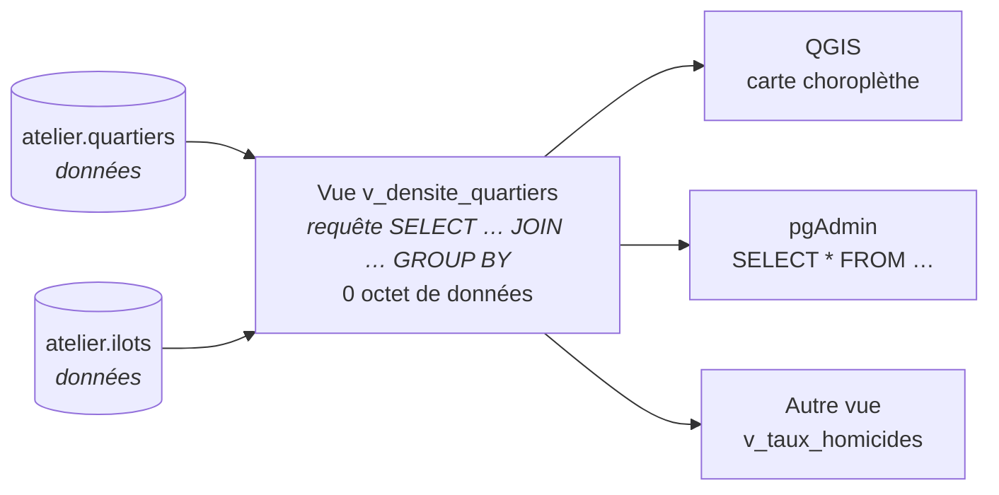
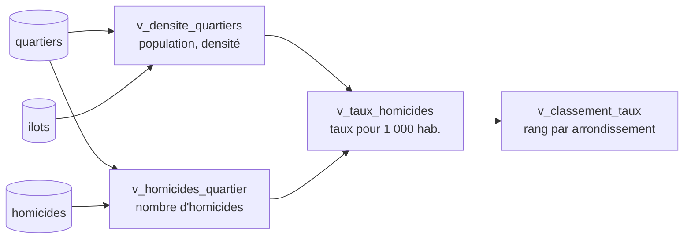
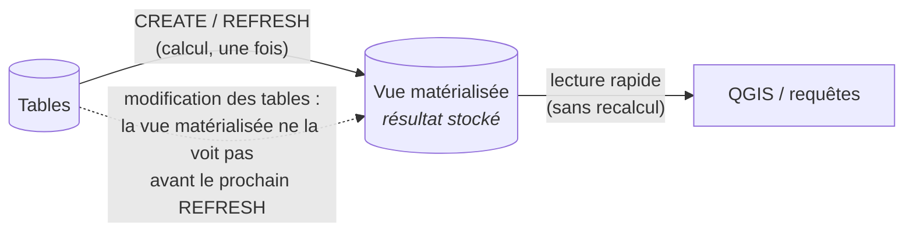

# GEO7531 — Les vues dans PostgreSQL / PostGIS

Une **vue** est une requête `SELECT` à laquelle on donne un nom, et qu'on utilise ensuite **comme une table**. Ce tutoriel explique en détail ce qu'est une vue, ce que PostgreSQL en fait, et comment l'utiliser en géomatique : couches dérivées pour QGIS sans dupliquer les données, analyses construites par étapes, vues matérialisées pour les calculs lourds, vues modifiables avec contrôle spatial, partage de données sans donner accès aux tables.

> **Pour qui ?** Étudiant·e·s qui connaissent le SQL de base et les jointures spatiales du cours (`ST_Contains`, `ST_Intersects`, `GROUP BY`).
> **Prérequis :** une base avec les données NYC restaurées (voir le tutoriel [Créer, restaurer et sauvegarder une base](../README.md)).

---

## Table des matières

0. [Avant de commencer : l'atelier](#0-avant-de-commencer--latelier)
1. [Qu'est-ce qu'une vue ?](#1-quest-ce-quune-vue-)
2. [Première vue, pas à pas](#2-première-vue-pas-à-pas)
3. [Des vues spatiales prêtes pour QGIS](#3-des-vues-spatiales-prêtes-pour-qgis)
4. [Construire une analyse par étapes : des vues de vues](#4-construire-une-analyse-par-étapes--des-vues-de-vues)
5. [Ce que fait PostgreSQL avec une vue](#5-ce-que-fait-postgresql-avec-une-vue)
6. [Les vues matérialisées](#6-les-vues-matérialisées)
7. [Écrire à travers une vue](#7-écrire-à-travers-une-vue)
8. [Partager des données sans tout montrer](#8-partager-des-données-sans-tout-montrer)
9. [Lister, modifier, documenter, supprimer](#9-lister-modifier-documenter-supprimer)
10. [Pièges et bonnes pratiques](#10-pièges-et-bonnes-pratiques)
11. [Exercices](#11-exercices)
12. [Aide-mémoire](#12-aide-mémoire)
13. [Références](#13-références)

Scripts du dossier [`scripts/`](scripts/), à exécuter dans l'ordre :

| Script | Section | Contenu |
|---|---|---|
| [`00_preparer_atelier.sql`](scripts/00_preparer_atelier.sql) | 0 | Copies des tables NYC dans le schéma `atelier` |
| [`01_premiere_vue.sql`](scripts/01_premiere_vue.sql) | 2 | Créer, utiliser, constater qu'une vue est toujours à jour |
| [`02_vues_spatiales_qgis.sql`](scripts/02_vues_spatiales_qgis.sql) | 3 | Jointure, choroplèthe, zones tampons, fusion : quatre couches pour QGIS |
| [`03_vues_en_cascade.sql`](scripts/03_vues_en_cascade.sql) | 4 | Taux d'homicides par quartier, en trois vues |
| [`04_sous_le_capot.sql`](scripts/04_sous_le_capot.sql) | 5 | Définition, plan d'exécution, coût |
| [`05_vues_materialisees.sql`](scripts/05_vues_materialisees.sql) | 6 | Stocker, indexer, rafraîchir |
| [`06_vues_modifiables.sql`](scripts/06_vues_modifiables.sql) | 7 | `INSERT` / `UPDATE` à travers une vue, `WITH CHECK OPTION` spatial |
| [`07_securite.sql`](scripts/07_securite.sql) | 8 | Donner accès à une vue, pas à la table |
| [`08_gerer.sql`](scripts/08_gerer.sql) | 9 | Lister, modifier, dépendances, `SELECT *` |
| [`09_exercices_solutions.sql`](scripts/09_exercices_solutions.sql) | 11 | Solutions des exercices |
| [`99_nettoyer.sql`](scripts/99_nettoyer.sql) | — | Tout effacer et recommencer |

---

## 0. Avant de commencer : l'atelier

Une vue ne modifie jamais les données… sauf quand on écrit à travers elle (section 7). Par prudence, le tutoriel travaille sur des **copies** des tables NYC, dans un schéma `atelier` :

| Table de l'atelier | Copie de | Lignes |
|---|---|---|
| `atelier.quartiers` | `nyc_neighborhoods` | 129 |
| `atelier.ilots` | `nyc_census_blocks` | 38 794 |
| `atelier.stations` | `nyc_subway_stations` | 491 |
| `atelier.rues` | `nyc_streets` | 19 091 |
| `atelier.homicides` | `nyc_homicides` | 3 984 |

1. Ouvrez le **Query Tool** sur la base qui contient les données NYC.
2. Exécutez [`scripts/00_preparer_atelier.sql`](scripts/00_preparer_atelier.sql).
3. Exécutez ensuite les scripts 01 à 09 dans l'ordre, **une requête à la fois** (sélectionnez-la, puis F5).

Pour tout recommencer : [`99_nettoyer.sql`](scripts/99_nettoyer.sql), puis le script 00.

> ℹ️ Dans pgAdmin, les vues apparaissent sous **Schemas → atelier → Views**, et les vues matérialisées sous **Materialized Views**.

---

## 1. Qu'est-ce qu'une vue ?

### L'idée

Une vue, c'est une **requête enregistrée sous un nom**. Elle ne contient **aucune donnée** : chaque fois qu'on l'interroge, PostgreSQL exécute sa requête sur les tables d'origine et renvoie le résultat, **toujours à jour**.

> 💡 **Analogie :** une vue est une **fenêtre** sur les tables. Elle ne contient rien, elle montre ce qu'il y a derrière, cadré d'une certaine façon (certaines colonnes, certaines lignes, des calculs). Si ce qu'il y a derrière change, la fenêtre le montre immédiatement.
>
> En SIG, c'est l'équivalent d'une **couche définie par une requête**, comme un filtre de couche dans QGIS, mais enregistrée dans la base et réutilisable par tous les logiciels.



### Table, vue ou vue matérialisée ?

| | **Table** | **Vue** | **Vue matérialisée** |
|---|---|---|---|
| Contient des données | Oui | **Non**, seulement une requête | Oui, le résultat de sa requête |
| À jour | — | **Toujours** | Seulement après `REFRESH` |
| Vitesse de lecture | Rapide | Celle de sa requête, **à chaque lecture** | Rapide |
| Espace disque | Oui | **Aucun** | Oui |
| Indexable | Oui | Non (on utilise les index des tables) | **Oui** |
| Modifiable (`INSERT`, `UPDATE`) | Oui | Si elle est simple (section 7) | Non |

### À quoi ça sert en géomatique ?

| Besoin | Avec une vue |
|---|---|
| Une couche « quartiers de Manhattan » dans QGIS | Une vue avec `WHERE boroname = 'Manhattan'`, sans copier les données |
| Une carte de densité de population toujours juste | Une vue qui joint quartiers et îlots : si un îlot change, la carte suit |
| Une requête complexe réutilisée par plusieurs personnes | Écrite une fois, appelée par son nom |
| Laisser un partenaire voir des totaux, pas les données détaillées | Accès à la vue, pas aux tables |
| Une couche d'édition limitée à une zone | Vue modifiable avec `WITH CHECK OPTION` |
| Un calcul lourd (`ST_Union` de tout un territoire) affiché souvent | Vue **matérialisée**, avec un index spatial |

---

## 2. Première vue, pas à pas

Script : [`01_premiere_vue.sql`](scripts/01_premiere_vue.sql)

**Créer**

```sql
CREATE VIEW atelier.v_quartiers_manhattan AS
SELECT id, name, geom
FROM atelier.quartiers
WHERE boroname = 'Manhattan';
```

C'est un `SELECT` ordinaire, précédé de `CREATE VIEW nom AS`. Rien n'est calculé à ce moment-là : PostgreSQL enregistre seulement la requête.

**Utiliser** — exactement comme une table :

```sql
SELECT count(*) FROM atelier.v_quartiers_manhattan;   -- 28

SELECT name, round((ST_Area(geom) / 1e6)::numeric, 2) AS km2
FROM atelier.v_quartiers_manhattan
ORDER BY km2 DESC
LIMIT 3;
```

**Constater qu'elle est toujours à jour.** On ajoute un quartier à Manhattan dans la **table** : la **vue** le voit immédiatement, sans rien faire.

```sql
INSERT INTO atelier.quartiers (name, boroname, geom)
VALUES ('Quartier fictif', 'Manhattan',
        ST_Multi(ST_Buffer(ST_GeomFromText('POINT(585000 4512000)', 26918), 200)));

SELECT count(*) FROM atelier.v_quartiers_manhattan;   -- 29

DELETE FROM atelier.quartiers WHERE name = 'Quartier fictif';
```

**Constater qu'elle ne contient rien :**

```sql
SELECT pg_size_pretty(pg_relation_size('atelier.quartiers'))             AS table_quartiers,
       pg_size_pretty(pg_relation_size('atelier.v_quartiers_manhattan')) AS vue;
-- la vue occupe 0 octet
```

> 💡 **Convention de nommage** utilisée ici : `v_…` pour les vues, `mv_…` pour les vues matérialisées. On les reconnaît ainsi d'un coup d'œil dans QGIS et pgAdmin.

---

## 3. Des vues spatiales prêtes pour QGIS

Script : [`02_vues_spatiales_qgis.sql`](scripts/02_vues_spatiales_qgis.sql)

C'est l'usage le plus courant en géomatique : produire des **couches dérivées** (filtrées, jointes, agrégées, recalculées) qui s'affichent dans QGIS **sans dupliquer les données**.

### Les deux conditions pour QGIS

1. **Un identifiant unique** (`id`). QGIS en a besoin pour distinguer les entités. Sans lui, ou avec des doublons, des entités disparaissent ou la sélection se comporte bizarrement.
2. **Une géométrie de type et de SRID connus.** Sinon QGIS demande le type et le SRID à chaque ajout de la couche, ou la refuse.

### A. Une jointure spatiale : chaque station avec son quartier

```sql
CREATE OR REPLACE VIEW atelier.v_stations_quartier AS
SELECT s.id, s.name, s.routes,
       q.name     AS quartier,
       q.boroname AS arrondissement,
       s.geom
FROM atelier.stations AS s
LEFT JOIN atelier.quartiers AS q
  ON ST_Contains(q.geom, s.geom);
```

La géométrie vient directement d'une colonne de table (`Point, 26918`) : son type est connu.

### B. Une choroplèthe : densité de population par quartier

```sql
CREATE OR REPLACE VIEW atelier.v_densite_quartiers AS
SELECT q.id, q.name, q.boroname,
       sum(i.popn_total) AS population,
       round((sum(i.popn_total) / (ST_Area(q.geom) / 1e6))::numeric) AS hab_km2,
       q.geom
FROM atelier.quartiers AS q
JOIN atelier.ilots AS i
  ON ST_Contains(q.geom, ST_PointOnSurface(i.geom))   -- un îlot = un seul quartier
GROUP BY q.id;
```

`GROUP BY q.id` suffit : comme `id` est la clé primaire de `quartiers`, PostgreSQL sait que `name`, `boroname` et `geom` en dépendent.

### C. Une géométrie calculée : zones de 500 m autour des stations

```sql
CREATE OR REPLACE VIEW atelier.v_zones_500m AS
SELECT id, name, routes,
       ST_Buffer(geom, 500)::geometry(Polygon, 26918) AS geom
FROM atelier.stations;
```

`ST_Buffer` renvoie un `geometry` « générique », sans type ni SRID déclarés. Le **transtypage** `::geometry(Polygon, 26918)` les annonce à PostGIS et à QGIS.

### D. Une géométrie agrégée : les arrondissements

```sql
CREATE OR REPLACE VIEW atelier.v_arrondissements AS
SELECT row_number() OVER (ORDER BY boroname) AS id,
       boroname,
       count(*) AS nb_quartiers,
       ST_Multi(ST_Union(geom))::geometry(MultiPolygon, 26918) AS geom
FROM atelier.quartiers
GROUP BY boroname;
```

Il n'y a pas d'identifiant après un regroupement : `row_number()` en fabrique un.

### Vérifier : `geometry_columns`

Les vues spatiales sont inscrites dans `geometry_columns`, comme les tables :

```sql
SELECT f_table_name, f_geometry_column, type, srid
FROM geometry_columns
WHERE f_table_schema = 'atelier'
ORDER BY f_table_name;
```

`v_zones_500m` y apparaît en `POLYGON` / `26918` grâce au transtypage. Sans lui, on lirait `GEOMETRY` / `0`.

### Dans QGIS

1. **Explorateur → PostgreSQL → *votre connexion* → atelier** : les vues apparaissent avec une icône particulière, à côté des tables.
2. Glissez `v_densite_quartiers` sur la carte. Si QGIS demande la **clé primaire**, choisissez `id`.
3. **Propriétés → Symbologie → Gradué** sur `hab_km2`.
4. Modifiez un îlot dans la table, puis rafraîchissez la carte (**F5**) : la densité suit.

> ⚠️ **Une vue se recalcule à chaque affichage.** Chaque déplacement ou zoom de la carte relance la requête. Pour `v_densite_quartiers`, qui joint 38 794 îlots, ou `v_arrondissements`, qui calcule un `ST_Union`, l'affichage peut devenir lent : c'est le cas d'usage des **vues matérialisées** (section 6).

---

## 4. Construire une analyse par étapes : des vues de vues

Script : [`03_vues_en_cascade.sql`](scripts/03_vues_en_cascade.sql)

**Question :** quels quartiers ont le plus d'homicides par habitant, dans chaque arrondissement ?

Plutôt qu'une seule requête de 40 lignes, on découpe en **petites vues**, chacune simple à lire et à vérifier. Une vue s'utilise dans une autre vue **exactement comme une table**.



```sql
-- Étape 1 : homicides par quartier (LEFT JOIN : zéros compris)
CREATE OR REPLACE VIEW atelier.v_homicides_quartier AS
SELECT q.id, count(h.id) AS nb_homicides
FROM atelier.quartiers AS q
LEFT JOIN atelier.homicides AS h ON ST_Contains(q.geom, h.geom)
GROUP BY q.id;

-- Étape 2 : on combine deux vues
CREATE OR REPLACE VIEW atelier.v_taux_homicides AS
SELECT d.id, d.name, d.boroname, d.population, h.nb_homicides,
       round(1000.0 * h.nb_homicides / NULLIF(d.population, 0), 2) AS taux_1000_hab,
       d.geom
FROM atelier.v_densite_quartiers AS d
JOIN atelier.v_homicides_quartier AS h USING (id)
WHERE d.population > 1000;

-- Étape 3 : classement dans chaque arrondissement
CREATE OR REPLACE VIEW atelier.v_classement_taux AS
SELECT name, boroname, taux_1000_hab,
       rank() OVER (PARTITION BY boroname ORDER BY taux_1000_hab DESC) AS rang
FROM atelier.v_taux_homicides;

SELECT * FROM atelier.v_classement_taux WHERE rang = 1;
```

Avantages : chaque étape se **teste seule** (`SELECT * FROM atelier.v_homicides_quartier`), `v_taux_homicides` s'affiche directement dans QGIS, et une correction faite à l'étape 1 se répercute partout.

---

## 5. Ce que fait PostgreSQL avec une vue

Script : [`04_sous_le_capot.sql`](scripts/04_sous_le_capot.sql)

**La définition est conservée** dans le catalogue du système :

```sql
SELECT pg_get_viewdef('atelier.v_stations_quartier'::regclass, true);
```

**À l'exécution, la vue est remplacée par sa requête.** PostgreSQL ne calcule pas d'abord toute la vue pour filtrer ensuite : il fusionne votre requête et celle de la vue, puis optimise l'ensemble.

```sql
EXPLAIN
SELECT * FROM atelier.v_stations_quartier
WHERE name = 'Broad St';
```

Le plan montre que le filtre `name = 'Broad St'` est appliqué directement sur `atelier.stations`, puis que l'**index GiST** de `atelier.quartiers` sert au `ST_Contains`. La même requête écrite sans vue donne **exactement le même plan**.

**Conséquences :**

- Une vue n'est **ni plus rapide ni plus lente** que sa requête. Elle sert à **organiser** le SQL, pas à l'accélérer.
- Les **index des tables** sont utilisés normalement.
- Le calcul est refait **à chaque lecture** : lancez deux fois `EXPLAIN ANALYZE SELECT * FROM atelier.v_densite_quartiers;`, le temps est à peu près le même.

---

## 6. Les vues matérialisées

Script : [`05_vues_materialisees.sql`](scripts/05_vues_materialisees.sql)

Une **vue matérialisée** exécute sa requête **une fois** et **stocke le résultat**, comme une table. La lecture est rapide, mais le résultat est **figé** jusqu'au prochain `REFRESH`.



**Créer et indexer**

```sql
CREATE MATERIALIZED VIEW atelier.mv_densite_quartiers AS
SELECT q.id, q.name, q.boroname,
       sum(i.popn_total) AS population,
       round((sum(i.popn_total) / (ST_Area(q.geom) / 1e6))::numeric) AS hab_km2,
       q.geom
FROM atelier.quartiers AS q
JOIN atelier.ilots AS i ON ST_Contains(q.geom, ST_PointOnSurface(i.geom))
GROUP BY q.id;

CREATE UNIQUE INDEX ON atelier.mv_densite_quartiers (id);             -- requis pour CONCURRENTLY
CREATE INDEX ON atelier.mv_densite_quartiers USING GIST (geom);       -- index spatial
```

Une vue matérialisée **peut avoir des index**, y compris un index spatial GiST, ce qui est impossible pour une vue ordinaire.

**Comparer la vitesse** (ligne *Execution Time*) :

```sql
EXPLAIN ANALYZE SELECT * FROM atelier.v_densite_quartiers;    -- recalcule tout
EXPLAIN ANALYZE SELECT * FROM atelier.mv_densite_quartiers;   -- lit le résultat stocké
```

**Le piège : le résultat est figé.** Le script double la population de Manhattan dans les îlots, puis compare :

```sql
SELECT 'vue' AS source, population FROM atelier.v_densite_quartiers  WHERE name = 'Chelsea'
UNION ALL
SELECT 'vue matérialisée', population FROM atelier.mv_densite_quartiers WHERE name = 'Chelsea';
```

La vue voit le changement ; la vue matérialisée montre encore l'ancienne valeur.

**Rafraîchir**

```sql
REFRESH MATERIALIZED VIEW atelier.mv_densite_quartiers;               -- bloque les lecteurs pendant le calcul
REFRESH MATERIALIZED VIEW CONCURRENTLY atelier.mv_densite_quartiers;  -- ne bloque pas (exige un index UNIQUE)
```

**Quand rafraîchir ?** Ce n'est jamais automatique. Selon le rythme de changement des données :

- à la main, après une mise à jour des données (chargement mensuel, par exemple) ;
- par une tâche planifiée (Planificateur de tâches Windows, `cron`, extension `pg_cron`) ;
- par un **déclencheur** `AFTER … FOR EACH STATEMENT` sur les tables d'origine (voir le tutoriel [Les déclencheurs](../declencheurs-postgis/README.md)), à éviter si elles changent souvent.

### Vue ou vue matérialisée ?

| Situation | Choix |
|---|---|
| Requête rapide, données qui changent souvent | **Vue** |
| Requête lente (`ST_Union`, grosses jointures), lue souvent, données qui changent rarement | **Vue matérialisée** |
| Couche QGIS qui doit refléter chaque modification immédiatement | **Vue** |
| Couche QGIS de fond (arrondissements, limites), lourde à calculer | **Vue matérialisée** + index GiST |
| Résultat à conserver tel quel, sans jamais le recalculer | **Table** (`CREATE TABLE … AS SELECT …`) |

---

## 7. Écrire à travers une vue

Script : [`06_vues_modifiables.sql`](scripts/06_vues_modifiables.sql)

### Les vues simples sont modifiables

Une vue est **automatiquement modifiable** si elle lit **une seule table**, sans `GROUP BY`, `DISTINCT`, agrégat (`count`, `sum`, `ST_Union`), fonction de fenêtre, `LIMIT` ni `UNION`. Un `INSERT`, `UPDATE` ou `DELETE` sur la vue est alors transmis à la table.

```sql
CREATE OR REPLACE VIEW atelier.v_stations_manhattan AS
SELECT id, name, borough, routes, geom
FROM atelier.stations
WHERE borough = 'Manhattan';

-- Est-elle modifiable ?
SELECT table_name, is_updatable, is_insertable_into
FROM information_schema.views
WHERE table_schema = 'atelier';
```

`v_stations_manhattan` est modifiable ; `v_densite_quartiers` (`GROUP BY`) et `v_stations_quartier` (jointure) ne le sont pas.

### Le problème des lignes « fantômes »

```sql
INSERT INTO atelier.v_stations_manhattan (name, borough, routes, geom)
VALUES ('Station fantôme', 'Brooklyn', 'Q', ST_GeomFromText('POINT(587000 4505000)', 26918));
```

L'insertion **réussit**, mais la station est à Brooklyn : elle n'apparaît pas dans la vue qui vient de la créer. Dans QGIS, l'entité « disparaît » dès qu'on enregistre.

### La solution : `WITH CHECK OPTION`

```sql
CREATE OR REPLACE VIEW atelier.v_stations_manhattan AS
SELECT id, name, borough, routes, geom
FROM atelier.stations
WHERE borough = 'Manhattan'
WITH CHECK OPTION;
```

Toute ligne écrite à travers la vue doit maintenant respecter son `WHERE` :
`ERREUR: new row violates check option for view "v_stations_manhattan"`.

### Une zone d'édition spatiale

Le `WHERE` peut être **spatial**. Voici une couche d'édition pour QGIS qui n'accepte que les stations situées dans le Financial District :

```sql
CREATE OR REPLACE VIEW atelier.v_edition_financial_district AS
SELECT id, name, routes, geom
FROM atelier.stations AS s
WHERE ST_Within(s.geom, (SELECT q.geom FROM atelier.quartiers AS q
                         WHERE q.name = 'Financial District'))
WITH CHECK OPTION;

-- Déplacer Broad St de 20 m : accepté
UPDATE atelier.v_edition_financial_district
SET geom = ST_Translate(geom, 20, 0) WHERE name = 'Broad St';

-- La déplacer de 3 km vers le nord : refusé, elle sortirait du quartier
UPDATE atelier.v_edition_financial_district
SET geom = ST_Translate(geom, 0, 3000) WHERE name = 'Broad St';
```

Dans QGIS, un point dessiné hors du quartier sera refusé à l'enregistrement de la couche, avec ce message d'erreur.

### Les colonnes calculées ne sont pas modifiables

Dans une vue qui affiche `ST_X(ST_Transform(geom, 4326)) AS lon`, on peut modifier `routes`, mais pas `lon` :
`ERREUR: cannot update column "lon" of view` — PostgreSQL ne sait pas « défaire » un calcul.

Pour rendre modifiables une vue calculée, une jointure ou un agrégat, il faut un **déclencheur `INSTEAD OF`** qui dit quoi faire à la place. Voir le tutoriel [Les déclencheurs](../declencheurs-postgis/README.md#9-rendre-une-vue-modifiable--instead-of), section 9.

---

## 8. Partager des données sans tout montrer

Script : [`07_securite.sql`](scripts/07_securite.sql)

**Scénario :** un partenaire doit voir la population **par quartier**, mais pas le détail des 38 794 îlots. On lui donne accès à une **vue**, et **pas** aux tables.

```sql
CREATE OR REPLACE VIEW atelier.v_population_publique AS
SELECT id, name, boroname, population, geom
FROM atelier.v_densite_quartiers;

CREATE ROLE partenaire_lecture NOLOGIN;
GRANT USAGE  ON SCHEMA atelier TO partenaire_lecture;
GRANT SELECT ON atelier.v_population_publique TO partenaire_lecture;
```

Essai, en se mettant « dans la peau » du partenaire :

```sql
SET ROLE partenaire_lecture;
SELECT name, population FROM atelier.v_population_publique LIMIT 3;   -- accepté
SELECT count(*) FROM atelier.ilots;                                   -- permission denied
RESET ROLE;
```

**Pourquoi la vue fonctionne-t-elle**, alors que le partenaire n'a aucun droit sur les tables ? Par défaut, une vue lit ses tables avec les droits de son **propriétaire** (ici `postgres`), pas avec ceux de la personne qui l'interroge. La vue sert de **guichet** : on choisit précisément ce qui passe.

**PostgreSQL 15 et plus — `security_invoker`.** Avec `WITH (security_invoker = true)`, la vue lit les tables avec les droits de l'**utilisateur**. Elle reste pratique pour simplifier les requêtes, mais ne contourne plus les droits.

```sql
CREATE OR REPLACE VIEW atelier.v_population_invoker
WITH (security_invoker = true) AS
SELECT name, population FROM atelier.v_densite_quartiers;
```

> 💡 La même approche sert pour un serveur cartographique (GeoServer, QGIS Server) : on publie des vues qui ne montrent que les colonnes et les lignes destinées au public.

---

## 9. Lister, modifier, documenter, supprimer

Script : [`08_gerer.sql`](scripts/08_gerer.sql)

**Lister**

```sql
SELECT table_name FROM information_schema.views WHERE table_schema = 'atelier';
SELECT matviewname, ispopulated FROM pg_matviews WHERE schemaname = 'atelier';
```

Dans psql : `\dv atelier.*` (vues) et `\dm atelier.*` (vues matérialisées).

**Modifier avec `CREATE OR REPLACE VIEW`**

| Permis | Interdit (il faut `DROP VIEW` puis `CREATE VIEW`) |
|---|---|
| Changer le `FROM`, le `WHERE`, les jointures, les calculs | Retirer une colonne |
| **Ajouter** des colonnes **à la fin** | Renommer ou réordonner des colonnes |
| | Changer le type d'une colonne |

Une vue matérialisée ne se « remplace » pas : il faut `DROP MATERIALIZED VIEW` puis `CREATE MATERIALIZED VIEW`.

**Dépendances.** PostgreSQL protège les vues : impossible de supprimer une colonne qu'une vue utilise.

```sql
ALTER TABLE atelier.quartiers DROP COLUMN boroname;
-- ERREUR: cannot drop column boroname … because other objects depend on it
-- DÉTAIL: view atelier.v_quartiers_manhattan depends on column boroname …
```

Le script 08 contient une requête qui liste toutes les vues dépendant d'une table.

> ⚠️ `DROP TABLE … CASCADE`, `DROP VIEW … CASCADE` ou `DROP COLUMN … CASCADE` suppriment **aussi toutes les vues qui en dépendent**, en cascade, sans autre avertissement.

**Documenter et renommer**

```sql
COMMENT ON VIEW atelier.v_densite_quartiers IS
  'Population et densité (hab./km²) par quartier. Un îlot est attribué au quartier qui contient son ST_PointOnSurface.';

ALTER VIEW atelier.v_zones_500m RENAME TO v_stations_tampon_500m;
```

Le commentaire s'affiche dans pgAdmin (onglet *Properties*) et dans le Gestionnaire BD de QGIS.

---

## 10. Pièges et bonnes pratiques

| Piège | Ce qui arrive | Comment l'éviter |
|---|---|---|
| **`SELECT *` figé** | Une colonne ajoutée à la table **n'apparaît pas** dans la vue : la liste des colonnes est mémorisée au `CREATE VIEW` | Nommez les colonnes. Pour en ajouter une, refaites la vue avec `CREATE OR REPLACE VIEW` |
| **Pas d'identifiant unique** | Dans QGIS, des entités manquent ou la sélection est incohérente | Gardez la clé primaire de la table, ou `row_number() OVER ()` après un `GROUP BY` |
| **Géométrie de type inconnu** | QGIS demande le type et le SRID, ou n'affiche rien | Transtypez : `ST_Buffer(geom, 500)::geometry(Polygon, 26918)` |
| **Vue lente dans QGIS** | La requête est relancée à chaque zoom ou déplacement | Vue matérialisée + index GiST, ou simplification (`ST_Simplify`) pour l'affichage |
| **Vue matérialisée périmée** | La carte montre des données d'hier sans que personne ne le remarque | Planifiez le `REFRESH` ; indiquez la date de mise à jour dans un `COMMENT` |
| **`ORDER BY` dans la vue** | Coût de tri inutile si la requête qui l'utilise trie autrement | Triez dans la requête finale, pas dans la vue |
| **Empilement de vues** | Cinq niveaux de vues deviennent difficiles à comprendre et à optimiser | Gardez des étapes courtes ; matérialisez une étape lourde |
| **Lignes fantômes** | Une ligne écrite par une vue modifiable n'y apparaît pas | `WITH CHECK OPTION` |
| **Suppression en cascade** | `DROP … CASCADE` emporte des vues utilisées par d'autres | Listez d'abord les dépendances (script 08) |

**Bon à savoir :**
- Une **sauvegarde** (`pg_dump` / *Backup*) contient la définition des vues. Les vues matérialisées sont recalculées à la restauration.
- Une vue peut lire des tables de **plusieurs schémas**. C'est pratique pour publier dans un schéma `public_web` des vues sur des données rangées ailleurs.
- `CREATE TABLE … AS SELECT …` crée une **table**, c'est-à-dire une copie figée qu'on ne peut pas rafraîchir. Préférez une vue matérialisée si le résultat doit être recalculé un jour.

---

## 11. Exercices

Faites d'abord les scripts 00 à 06. Solutions complètes dans [`09_exercices_solutions.sql`](scripts/09_exercices_solutions.sql).

**Exercice 1 — Couche des autoroutes.** Créez une vue `v_autoroutes` des rues de type `motorway` ou `motorway_link`, prête pour QGIS. Quelle est leur longueur totale en km ?

<details>
<summary>Solution</summary>

```sql
CREATE OR REPLACE VIEW atelier.v_autoroutes AS
SELECT id, name, type, geom
FROM atelier.rues
WHERE type IN ('motorway', 'motorway_link');

SELECT count(*), round(sum(ST_Length(geom)) / 1000) AS km
FROM atelier.v_autoroutes;
```
</details>

**Exercice 2 — Homicides en contexte.** Créez une vue qui donne, pour chaque homicide, son quartier et la station de métro la plus proche avec sa distance.

<details>
<summary>Indice et solution</summary>

`LEFT JOIN … ST_Contains` pour le quartier, `CROSS JOIN LATERAL (… ORDER BY geom <-> h.geom LIMIT 1)` pour la station.

```sql
CREATE OR REPLACE VIEW atelier.v_homicides_contexte AS
SELECT h.id, h.year, h.weapon,
       q.name AS quartier,
       s.name AS station_proche,
       round(ST_Distance(h.geom, s.geom)) AS dist_station_m,
       h.geom
FROM atelier.homicides AS h
LEFT JOIN atelier.quartiers AS q ON ST_Contains(q.geom, h.geom)
CROSS JOIN LATERAL (
  SELECT name, geom FROM atelier.stations
  ORDER BY geom <-> h.geom
  LIMIT 1
) AS s;
```
</details>

**Exercice 3 — Longueur de rues par arrondissement, matérialisée.** À partir de `mv_arrondissements` (section 6), créez une vue matérialisée indexée donnant la longueur de rues (km) de chaque arrondissement, en découpant les rues aux limites.

<details>
<summary>Solution</summary>

```sql
CREATE MATERIALIZED VIEW atelier.mv_longueur_rues AS
SELECT a.id, a.boroname,
       round(sum(ST_Length(ST_Intersection(r.geom, a.geom))) / 1000) AS km_rues,
       a.geom
FROM atelier.mv_arrondissements AS a
JOIN atelier.rues AS r ON ST_Intersects(r.geom, a.geom)
GROUP BY a.id, a.boroname, a.geom;

CREATE UNIQUE INDEX ON atelier.mv_longueur_rues (id);
CREATE INDEX ON atelier.mv_longueur_rues USING GIST (geom);
```
</details>

**Exercice 4 — Couche d'édition.** Créez une vue modifiable des rues à sens unique (`oneway = 'yes'`) qui refuse qu'on y passe une rue à double sens. Vérifiez qu'un `UPDATE … SET oneway = 'no'` est refusé.

<details>
<summary>Solution</summary>

```sql
CREATE OR REPLACE VIEW atelier.v_edition_sens_unique AS
SELECT id, name, oneway, geom
FROM atelier.rues
WHERE oneway = 'yes'
WITH CHECK OPTION;

UPDATE atelier.v_edition_sens_unique
SET oneway = 'no'
WHERE id = (SELECT min(id) FROM atelier.v_edition_sens_unique);
-- ERREUR: new row violates check option for view "v_edition_sens_unique"
```
</details>

---

## 12. Aide-mémoire

```sql
-- Vue
CREATE OR REPLACE VIEW schema.v_nom AS
SELECT id, …, geom                       -- id unique + géométrie typée pour QGIS
FROM …
WHERE …;

-- Vue modifiable qui refuse les lignes hors de son WHERE
CREATE OR REPLACE VIEW schema.v_edition AS
SELECT id, …, geom FROM une_seule_table WHERE …
WITH CHECK OPTION;

-- Vue matérialisée
CREATE MATERIALIZED VIEW schema.mv_nom AS SELECT …;
CREATE UNIQUE INDEX ON schema.mv_nom (id);
CREATE INDEX ON schema.mv_nom USING GIST (geom);
REFRESH MATERIALIZED VIEW CONCURRENTLY schema.mv_nom;

-- Géométrie calculée : annoncer type et SRID
ST_Buffer(geom, 500)::geometry(Polygon, 26918) AS geom

-- Identifiant après un GROUP BY
row_number() OVER (ORDER BY …) AS id

-- Gérer
SELECT pg_get_viewdef('schema.v_nom'::regclass, true);
COMMENT ON VIEW schema.v_nom IS '…';
DROP VIEW IF EXISTS schema.v_nom;
DROP MATERIALIZED VIEW IF EXISTS schema.mv_nom;
```

| Je veux… | J'utilise |
|---|---|
| Une couche filtrée, jointe ou calculée, toujours à jour | `CREATE VIEW` |
| Une couche lourde à calculer, lue souvent | `CREATE MATERIALIZED VIEW` + index GiST + `REFRESH` |
| Éditer une partie d'une table, sans pouvoir en sortir | Vue simple + `WITH CHECK OPTION` |
| Éditer une vue calculée ou jointe | Déclencheur `INSTEAD OF` |
| Donner accès à un résumé, pas aux données | `GRANT SELECT` sur la vue seulement |
| Une copie figée, définitive | `CREATE TABLE … AS SELECT …` |

---

## 13. Références

- [PostgreSQL : commande CREATE VIEW (vues modifiables, CHECK OPTION, security_invoker)](https://www.postgresql.org/docs/current/sql-createview.html)
- [PostgreSQL : les vues dans le système de règles](https://www.postgresql.org/docs/current/rules-views.html)
- [PostgreSQL : les vues matérialisées](https://www.postgresql.org/docs/current/rules-materializedviews.html)
- [PostgreSQL : REFRESH MATERIALIZED VIEW](https://www.postgresql.org/docs/current/sql-refreshmaterializedview.html)
- [PostGIS : la vue geometry_columns](https://postgis.net/docs/using_postgis_dbmanagement.html#geometry_columns)

---

*Cours GEO7531 — document de consultation.*
